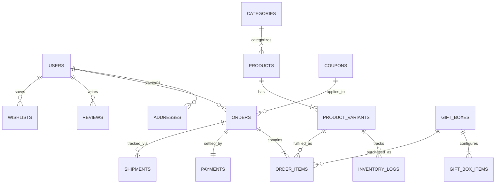
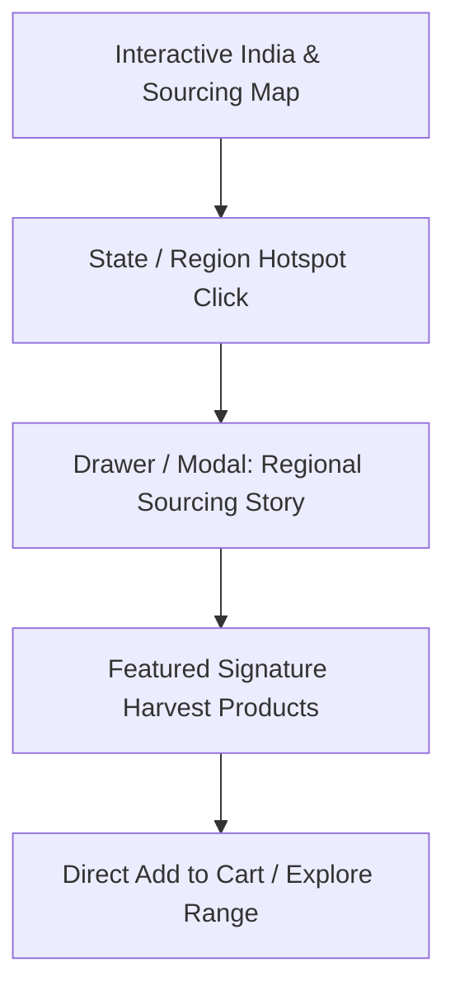

# CLIENT REQUIREMENTS DOCUMENT (CRD / BRD / SRS)
## Project: M/S Fruits & Nuts Premium E-Commerce Platform
**Document Version:** 1.0.0  
**Status:** DRAFT FOR CLIENT REVIEW & SIGN-OFF  
**Role:** Lead Product Consultant, Principal Business Analyst & E-Commerce Solutions Architect  
**Brand Identity:** M/S Fruits & Nuts  
**Official Domain:** `https://www.fruitsandnuts.co.in/`  
**Target Environment:** Production-grade, Database-backed, API-driven, Cloud-Scalable E-Commerce Ecosystem  

---

## EXECUTIVE SUMMARY & PURPOSE

This document establishes the definitive business, functional, non-functional, technical, and regulatory requirements for engineering the flagship e-commerce platform for **M/S Fruits & Nuts**. 

The goal of this engagement is to develop a bespoke, high-converting, omnichannel-ready online marketplace delivering a luxury gourmet experience for premium dry fruits, artisanal nuts, imported dates, seeds, wellness teas, handcrafted chocolates, royal mouth fresheners, and bespoke corporate/festive gifting boxes.

> **CRITICAL COMPLIANCE NOTICE & GOVERNANCE RULES:**
> 1. **No Code Phase:** This document constitutes Phase 1 (Discovery & Formal Specifications). No software implementation will commence prior to formal sign-off.
> 2. **Anti-Plagiarism & IP Boundary:** Reference platforms (*Nutraj*, *Sindhi Dry Fruits*, *Palak Tea*) serve strictly as UX and category benchmarks. Zero code, graphic assets, typography, copy, or UI elements shall be copied.
> 3. **Draft Content & Health Claims Guardrail:** All handwritten/client-drafted health benefits, wellness attributes, and origin claims are marked `[CLIENT CONFIRMATION REQUIRED]` and quarantined from production deployment until vetted against FSSAI and legal advertising standards.
> 4. **Deterministic Information Integrity:** Missing or ambiguous pricing, addresses, tax rates, logistics credentials, or operational metrics are documented with explicit escalation tags rather than synthesized assumptions.

---

## TABLE OF CONTENTS
1. [Business Requirements](#1-business-requirements)
2. [Product Requirements & Catalog Architecture](#2-product-requirements--catalog-architecture)
3. [Customer Experience & Storefront Functional Requirements](#3-customer-experience--storefront-functional-requirements)
4. [Administrative & Operations Management Requirements](#4-administrative--operations-management-requirements)
5. [Content & Copywriting Requirements (Draft & Compliance)](#5-content--copywriting-requirements-draft--compliance)
6. [Asset & Media Organization Requirements](#6-asset--media-organization-requirements)
7. [E-Commerce Core Engine Requirements](#7-e-commerce-core-engine-requirements)
8. [Payment Gateway & Financial Accounting Requirements](#8-payment-gateway--financial-accounting-requirements)
9. [Content Management System (CMS) Requirements](#9-content-management-system-cms-requirements)
10. [Interactive India Taste Map Requirements](#10-interactive-india-taste-map-requirements)
11. [Store & Physical Outlet Directory Requirements](#11-store--physical-outlet-directory-requirements)
12. [Search Engine Optimization (SEO) Requirements](#12-search-engine-optimization-seo-requirements)
13. [Security, Identity & Data Privacy Requirements](#13-security-identity--data-privacy-requirements)
14. [Performance, Scalability & Reliability Requirements](#14-performance-scalability--reliability-requirements)
15. [Legal, Regulatory, Policy & Compliance Requirements](#15-legal-regulatory-policy--compliance-requirements)
16. [Third-Party Integration & API Requirements](#16-third-party-integration--api-requirements)
17. [Client Dependencies & Deliverable Prerequisites](#17-client-dependencies--deliverable-prerequisites)
18. [Unknown, Ambiguous & Missing Information Registry](#18-unknown-ambiguous--missing-information-registry)
19. [Risk Assessment & Mitigation Matrix](#19-risk-assessment--mitigation-matrix)
20. [Client Approval, Sign-Off & Phase Transition Checklist](#20-client-approval-sign-off--phase-transition-checklist)

---

## 1. BUSINESS REQUIREMENTS

### 1.1 Brand Identity & Commercial Vision
- **Entity:** M/S Fruits & Nuts
- **Digital Flagship:** `https://www.fruitsandnuts.co.in/`
- **Core Value Proposition:** Sourcing the world's and India's finest gourmet harvests—vacuum-packed, nitrogen-flushed, hygienically processed, and luxury-presented for retail, wholesale, wellness, and gifting consumers.
- **Brand Positioning:** Premium, trustworthy, heritage-rooted yet modern, uncompromising on grading, freshness, and presentation.

### 1.2 Target Audience Segments
1. **D2C Retail Gourmands:** Health-conscious individuals, fitness enthusiasts, homemakers seeking certified grade-A dry fruits, seeds, and superfoods.
2. **Festive & Personal Gifting Buyers:** High-AOV shoppers seeking customizable gift hampers, luxury wooden/tin boxes, personalized message cards, and wedding/festival assortments.
3. **B2B / Corporate / Institutional Clients:** Corporate procurement officers ordering bulk employee hampers, event organizers, and retail sub-distributors requiring tiered wholesale pricing, GST invoicing, and volume delivery schedules.
4. **Tea & Confectionery Connoisseurs:** Niche buyers seeking single-estate teas, artisan-infused chocolates, and heritage digestive mouth fresheners.

### 1.3 Revenue Channels & Monetization Models
- **Direct-to-Consumer (D2C) Retail:** Standard e-commerce checkout with instant payment, tiered cart discounts, and loyalty perks.
- **Build Your Own Box (BYOB) Engine:** Dynamic pricing model combining custom container costs, selected item unit weights, and custom embellishments.
- **Bulk / Wholesale Inquiries & Orders:** Tiered minimum order quantity (MOQ) pricing matrix with GST input tax credit pass-through and quote generation workflows.
- **Subscription / Recurring Deliveries (Phase 2 Consideration):** Automated monthly replenishment for daily staples (almonds, walnuts, daily seed mixes). `[CLIENT CONFIRMATION REQUIRED]`

---

## 2. PRODUCT REQUIREMENTS & CATALOG ARCHITECTURE

### 2.1 Master Taxonomy & Categories
The platform catalog must support multi-level nested hierarchies, cross-tagging, and dynamic collection filtering.

```
M/S Fruits & Nuts Catalog Root
├── 1. Fruits & Nuts (Whole, Sliced, Roasted, Salted, Flavored)
├── 2. Premium Dry Fruits (Almonds, Cashews, Walnuts, Pistachios, Raisins, Figs/Anjeer, Apricots, Berries, Prunes)
├── 3. Dates / Khajoor (Medjool, Ajwa, Safawi, Mabroom, Kalmi, Stuffed Dates, Chocolate Coated Dates)
├── 4. Super Seeds & Edible Kernels (Chia, Flax, Pumpkin, Sunflower, Watermelon, Roasted Seed Mixes)
├── 5. Artisan Tea Collection (Loose Leaf, CTC, Green Tea, Herbal Infusions, Masala Chai, White Tea, Kashmiri Kahwa)
├── 6. Gourmet Chocolates & Confections (Dark Chocolates, Nut Clusters, Chocolate-dipped Fruits, Dragées)
├── 7. Royal Mouth Fresheners / Mukhwas (Paan Betel Mixes, Silver-coated Cardamom, Fennel Seed Mixes, Digestives)
├── 8. Value Combos & Daily Nutrition Packs (Pre-curated bundles, Family packs, Fitness packs)
├── 9. Gift Packs & Luxury Gifting (Wooden Treasure Boxes, Velvet Trays, Tin Hampers, Festival Hampers)
│   └── 9.1 "Build Your Own Box" (BYOB) Interactive Configurator
└── 10. Specialty & Allied Products (Cold-pressed Nut Oils, Saffron/Kesar, Honey, Organic Spices)
```

### 2.2 Product Variant Matrix & Attributes
Every product record must support granular attribute modeling:

| Attribute Dimension | Supported Options & Schema Definition |
| :--- | :--- |
| **Packaging Types** | Stand-up Zip Pouch, Nitrogen Flushed Tin, Vacuum Pack, Luxury Glass Jar, Wooden Keepsake Box, Gift Box |
| **Weight / Volume Variants** | `50g`, `100g`, `200g`, `250g`, `400g`, `500g`, `1kg`, `2kg`, `5kg (Bulk)`, Custom Unit Weight |
| **Grading & Form** | Jumbo / Mammoth, W180, W240, W320, Whole Kernels, Halves, Broken/Pieces, Organic Certified |
| **Roast & Flavor Profile** | Raw/Natural, Lightly Salted, Peri-Peri, Smoked BBQ, Cream & Onion, Honey Glazed, Caramel, Saffron Infused |
| **Origin Designation** | Kashmir (India), California (USA), Iran, Afghanistan, Saudi Arabia, Chile, Australia, Oman `[CLIENT CONFIRMATION REQUIRED]` |
| **Dietary & Lifestyle Tags** | 100% Vegan, Gluten-Free, Keto-Friendly, Zero Added Sugar, Diabetic-Friendly, Non-GMO, FSSAI Certified |

### 2.3 Pricing Models: Retail vs. Wholesale
1. **D2C Retail Pricing:**
   - Base MRP (Maximum Retail Price - strikethrough display).
   - Selling Price (Inclusive/Exclusive of GST indicator).
   - Automatic percentage discount computation (`Save X%`).
2. **B2B Tiered / Wholesale Pricing:**
   - Volume Breakpoints (e.g., Tier 1: 1-5 units @ Retail; Tier 2: 6-20 units @ 12% off; Tier 3: 21-50 units @ 20% off; Tier 4: 51+ units @ Wholesale Quote).
   - Dynamic Price Tiering displayed on PDP for registered B2B accounts.
   - Separate B2B RFQ (Request for Quote) button for institutional requirements.

### 2.4 Inventory Management Specifications
- Variant-level SKU tracking with separate safety stock thresholds.
- Low-stock visual warnings (e.g., "Only 3 left in stock!").
- Out-of-stock backorder toggles: (a) Disable Add-to-Cart, or (b) Enable "Notify Me When Available" waitlist trigger.
- Batch/Lot number mapping and Expiry/Best-Before date tracking for perishable food safety.

---

## 3. CUSTOMER EXPERIENCE & STOREFRONT FUNCTIONAL REQUIREMENTS

### 3.1 Discovery, Navigation & Search
- **Predictive Search Bar:** Instant autocomplete with product thumbnail, category suggestions, SKU lookup, and typo tolerance.
- **Faceted Multi-Filter Engine:** Filter concurrently by:
  - Category / Subcategory
  - Price Range Slider (₹ Min - ₹ Max)
  - Net Weight (`250g`, `500g`, `1kg`, etc.)
  - Dietary Preference (Gluten-Free, No Sugar, Vegan)
  - Flavor / Roast Profile
  - Origin / Region
  - In-Stock Only toggle
- **Sorting Options:** Featured / Bestsellers, Price: Low to High, Price: High to Low, Customer Rating, Newest Arrivals, Percentage Discount.

### 3.2 Product Detail Page (PDP) Architecture
- **Media Gallery:** Multi-angle image zoom (magnifier lens), packaging view, nutritional table snapshot, video clip carousel.
- **Variant Selector:** Interactive visual chips for Weight (`250g`, `500g`, `1kg`) with instant dynamic price and stock state recalculation without full page reload.
- **Pincode Delivery Check:** Live delivery estimate and COD eligibility widget via courier API.
- **Nutrition & Ingredient Panel:** Structured tabbed view:
  - Product Description & Gourmet Story
  - Nutritional Facts Table per 100g (Energy, Protein, Healthy Fats, Carbs, Dietary Fiber, Micronutrients)
  - Health & Wellness Insights *(guarded by compliance clearance)*
  - Storage & Shelf Life Instructions (e.g., "Store in a cool, dry place in an airtight container")
  - Allergen Warnings (e.g., "Contains Tree Nuts. Processed in a facility handling dairy and soy.")
  - FSSAI License & Country of Origin declaration.
- **Social Proof:** Verified buyer reviews, photo ratings, average star score summary, and Q&A section.
- **Cross-Selling & Recommendations:** "Frequently Bought Together", "Pairs Well With", "Similar Products in Category".

### 3.3 "Build Your Own Box" (BYOB) Interactive Gifting Experience
1. **Step 1: Select Box Style & Capacity:** (e.g., Classic 2-Jar, Premium 4-Jar Wooden Casket, Royal 6-Compartment Velvet Box, Festival Tin).
2. **Step 2: Choose Components / Fillers:** Select from categorized dry fruits, dates, exotic nuts, tea canisters, or chocolates. Real-time visual slots fill up with weight verification.
3. **Step 3: Personalization & Ribbon Add-ons:** Custom greeting card text entry, selection of festive sleeves (Diwali, Eid, Wedding, Corporate, New Year), optional custom branding tag.
4. **Step 4: Dynamic Cost Calculation & Add to Cart:** Real-time composite price updates dynamically based on box base price + aggregate contents + custom embellishments.

### 3.4 Cart, Wishlist & Save for Later
- **Slide-out Mini-Cart (Drawer) & Dedicated Cart Page:**
  - Real-time line-item quantity adjusters (`+` / `-`).
  - Free shipping progress threshold indicator (e.g., *"Add ₹250 more to unlock FREE Delivery"*).
  - Coupon Code input with real-time validation and instant discount display.
  - Cart-level gifting options (Gift Wrap toggle + ₹50, Greeting Message).
- **Persistent Wishlist:** Accessible across sessions for logged-in and guest users (session-stored for guests, cloud-synced upon login).

### 3.5 Checkout Funnel & Customer Accounts
- **One-Page Accelerated Checkout:**
  - Phone Number OTP or Email Magic Link login option (guest checkout permitted).
  - Multi-address book (Home, Office, Other) with default selector.
  - GSTIN entry field for B2B buyers with automatic company name validation.
  - Shipping method selector (Standard Delivery, Express/Priority Air).
  - Payment gateway selector (UPI, Credit/Debit Cards, Net Banking, EMI, Wallets, Cash on Delivery).
- **Customer Self-Service Portal:**
  - Order history with live milestone tracking (Order Placed -> Packed -> Shipped -> Out for Delivery -> Delivered).
  - Instant PDF Invoice download.
  - One-click order reorder function.
  - Return / Replacement request initiation within policy window.

---

## 4. ADMINISTRATIVE & OPERATIONS MANAGEMENT REQUIREMENTS

### 4.1 Master Catalog & Inventory Management
- Full CRUD interface for Products, Categories, Collections, Brands, and Vendors.
- Bulk CSV / Excel Import and Export for pricing, stock updates, SKU mappings, and metadata.
- Low inventory automated email alerts and threshold config.
- Batch pricing editor (e.g., apply 10% discount across entire "Dates" category).

### 4.2 Order Processing & Fulfillment Workflow
- Unified Order Dashboard with filtering by status: `Pending`, `Payment Confirmed`, `Processing`, `Awaiting Pickup`, `Shipped`, `Delivered`, `Cancelled`, `Refunded`.
- One-click generation of Tax Invoices, Packing Slips, and Thermal Shipping Labels (A4 and 4x6 inch format).
- Integrated Courier Manifest generation and AWB (Air Waybill) assignment.
- Manual order creation tool for telephonic / offline client orders.

### 4.3 Customer & B2B Account Management
- Complete customer database with lifetime value (LTV), total orders, average order value (AOV), and customer tags (VIP, Wholesale, High Return Risk).
- B2B Account Verification Panel: Approve/Reject B2B accounts, upload tax exemption certificates, assign custom wholesale discount groups.

### 4.4 Promotions, Coupons & Loyalty Engine
- Discount Engine supporting:
  - Percentage discount (e.g., `FLAT15` -> 15% off).
  - Fixed amount discount (e.g., `FESTIVE500` -> ₹500 off on min order ₹2,500).
  - BOGO (Buy X Get Y Free) and Category-specific coupons.
  - First-time buyer exclusive coupon (`WELCOME10`).
  - Usage limits per user, total usage limits, minimum order spend thresholds, and date validity windows.

### 4.5 Store Analytics, Reporting & Business Intelligence
- Real-time sales telemetry: Revenue, Orders, Average Order Value, Conversion Rate.
- Top-selling SKUs, Dead-stock analysis, and Inventory Turnover velocity.
- Geographic sales heatmaps (States / Cities breakdown).
- Abandoned Cart recovery dashboard with automated recovery email/WhatsApp triggers.

---

## 5. CONTENT & COPYWRITING REQUIREMENTS (DRAFT & COMPLIANCE)

### 5.1 Handwritten / Client-Drafted Content Handling Protocol
All product benefits, wellness notes, and nutritional references provided in client drafts are classified as **CLIENT-SUPPLIED DRAFT CONTENT**.

```
[DRAFT INGESTION] -> [COMPLIANCE REVIEW] -> [FSSAI ADVERTISING SCREEN] -> [CLIENT SIGN-OFF] -> [PRODUCTION DEPLOYMENT]
```

### 5.2 Health Claims Compliance & Regulatory Guardrails
Under the Food Safety and Standards (Advertising and Claims) Regulations of India:
- **Prohibited Claims:** The platform MUST NOT claim that any dry fruit, nut, seed, or tea "cures", "treats", "prevents", or "eradicates" medical diseases (e.g., cancer, diabetes, hypertension, cardiovascular disease).
- **Permissible Descriptive Framing:** Nutritional structure/function wording must be used instead:
  - *Non-compliant:* "Cures high blood pressure and cleanses arteries."
  - *Compliant Alternative:* "Rich in monounsaturated healthy fats and potassium, which help support cardiovascular wellness as part of a balanced diet."
- **Mandatory Flagging:** Every product description containing therapeutic or physiological claims is explicitly marked with `[CLIENT CONFIRMATION REQUIRED]` in the Master Data Sheet before publishing.

### 5.3 Mandatory Packaging & Statutory Disclaimers
Each product page must render standard statutory disclaimers:
> *"Disclaimer: While we endeavor to ensure the accuracy of all product information, actual product packaging and materials may contain more or different information. Please read labels, warnings, and directions before consuming. Store in a cool, dry place. All health claims are for dietary information purposes only and should not replace professional medical advice."*

---

## 6. ASSET & MEDIA ORGANIZATION REQUIREMENTS

### 6.1 Asset Ingestion & Integrity Principles
- Client-provided product photography, packaging renders, master logos, and brand marks constitute the **SINGLE SOURCE OF TRUTH**.
- No placeholder or random AI-generated mockups shall be introduced into the production catalog.
- Original raw files must be archived in an immutable master asset vault.

### 6.2 Standardized File Structure & Naming Conventions
```
/assets/client-media/
├── branding/
│   ├── logo/ (fruits-and-nuts-logo-primary.svg, logo-white.svg, favicon.ico)
│   ├── typography/
│   └── certificates/ (fssai-license-certificate.pdf, iso-cert.pdf)
├── products/
│   ├── dry-fruits/
│   │   ├── almonds-california-mamra/
│   │   │   ├── fn-df-alm-001-primary.webp
│   │   │   ├── fn-df-alm-001-packaging.webp
│   │   │   ├── fn-df-alm-001-nutrition.webp
│   │   │   └── fn-df-alm-001-lifestyle.webp
│   │   └── cashews-w180-jumbo/
│   ├── dates-khajoor/
│   ├── seeds/
│   ├── tea/
│   ├── chocolates/
│   ├── mouth-fresheners/
│   └── combos-gifts/
├── banners-hero/
│   ├── desktop/ (hero-festive-gifting-1920x800.webp)
│   └── mobile/ (hero-festive-gifting-768x900.webp)
└── taste-map/
    └── regions/ (kashmir-walnuts.webp, goa-cashews.webp, kerala-spices.webp)
```

### 6.3 Technical Media Optimization Standards
- **Image Formats:** WebP / AVIF with automated fallback to JPG/PNG for legacy clients.
- **Compression Targets:** Zero visible degradation; hero images < 200 KB; product catalog thumbnails < 60 KB.
- **Responsive Sizing:** Dynamic `srcset` delivering tailored resolutions for 1x, 2x Retina, Mobile, Tablet, and Desktop viewports.

---

## 7. E-COMMERCE CORE ENGINE REQUIREMENTS

### 7.1 Data Architecture & Schema Entity Model
The platform database schema must enforce relational integrity across core entities:



### 7.2 Cart Calculation & Taxation Engine
- Real-time precision calculation handling:
  $$\text{Line Item Subtotal} = \text{Unit Variant Price} \times \text{Quantity}$$
  $$\text{Cart Base Total} = \sum \text{Line Item Subtotals}$$
  $$\text{Discounted Total} = \text{Cart Base Total} - \text{Coupon Discount} - \text{Tiered Discount}$$
  $$\text{Applicable GST} = \text{CGST} + \text{SGST} \text{ (Intra-state)} \quad \text{OR} \quad \text{IGST} \text{ (Inter-state)}$$
  $$\text{Shipping Fee} = \begin{cases} 0 & \text{if Discounted Total} \ge \text{Free Shipping Threshold} \\ \text{Base Flat Rate} & \text{otherwise} \end{cases}$$
  $$\text{Final Payable Total} = \text{Discounted Total} + \text{Applicable Taxes} + \text{Shipping Fee} + \text{Gift Wrap Fee}$$

---

## 8. PAYMENT GATEWAY & FINANCIAL ACCOUNTING REQUIREMENTS

### 8.1 Multi-Gateway Integration Architecture
- **Primary Indian Payment Gateways:** Razorpay / Cashfree / PhonePe Payment Gateway. `[CLIENT CONFIRMATION REQUIRED on gateway account credentials]`
- **Payment Method Support:**
  - **UPI:** Instant intent flow (Google Pay, PhonePe, Paytm, BHIM, CRED) and QR Code generation.
  - **Cards:** Visa, MasterCard, RuPay, American Express (with mandatory 3D Secure / RBI tokenization compliance).
  - **Net Banking:** Support across 50+ Indian commercial and public sector banks.
  - **Digital Wallets:** Paytm, Mobikwik, Amazon Pay.
  - **Cash on Delivery (COD):** Dynamic COD verification via SMS OTP to prevent bogus orders; optional configurable COD convenience surcharge (e.g., ₹50).
- **International Payments (Phase 2):** Stripe / PayPal for cross-border diaspora orders. `[CLIENT CONFIRMATION REQUIRED]`

### 8.2 Webhook Handling & Failure Reconciliation
- Robust webhook listeners to capture asynchronous payment states (`payment.captured`, `payment.failed`, `refund.processed`).
- Automated idempotency handling to prevent double billing or duplicate order generation.
- Real-time automated transaction retry mechanism with intuitive customer error messaging on gateway timeout.

### 8.3 GST Compliance, B2B Invoicing & Tax Invoices
- Generation of GST-compliant Tax Invoices featuring:
  - Seller Registered Trade Name & Legal Name: M/S Fruits & Nuts
  - Seller GSTIN, PAN, and Registered Office Address
  - State of Supply & State Code (e.g., 07 - Delhi, 27 - Maharashtra)
  - Buyer Billing & Shipping Address + Buyer GSTIN (for B2B input tax credit)
  - HSN Codes assigned per category:
    - *Dry Fruits & Nuts (HSN 0801, 0802, 0806, etc.)*
    - *Dates / Khajoor (HSN 0804)*
    - *Tea (HSN 0902)*
    - *Chocolates & Confectionery (HSN 1806)*
    - *Mouth Fresheners / Mukhwas (HSN 2106)*
  - Clear itemized split of Taxable Value, CGST %, SGST %, IGST %, and Total Tax.

---

## 9. CONTENT MANAGEMENT SYSTEM (CMS) REQUIREMENTS

### 9.1 Visual Layout & Section Management
The Admin CMS must provide full control over homepage and promotional landing page components without developer intervention:
- **Hero Slider / Banner Manager:** Desktop and mobile banner upload, headline, CTA label, target URL link, scheduling start/end dates.
- **Featured Product Grids & Carousels:** Dynamic curation ("New Arrivals", "Festive Specials", "Chef's Picks", "Top Rated").
- **Promotional Marquees / Announcement Bar:** Top notification banner with custom background color and scrolling ticker (e.g., *"Free shipping on orders above ₹999 | Use Code: NUTS10 for 10% Off"*).
- **Customer Testimonials & Press Mentions:** Manage video embeds, quoted reviews, and press logos.

### 9.2 Informational & Policy Page Builder
Rich text (WYSIWYG / Markdown) page management for:
- About Us (The Heritage & Sourcing Story of M/S Fruits & Nuts)
- Sourcing & Quality Standards
- Corporate & Bulk Gifting Inquiries
- FAQs (Categorized by Ordering, Shipping, Quality, Returns, Storage)
- Blog / Health Journal (Recipes, Nut Health Guides, Lifestyle articles)

---

## 10. INTERACTIVE INDIA TASTE MAP REQUIREMENTS

### 10.1 Concept & Experiential Objective
The **India Taste Map** is a bespoke interactive visual feature celebrating India's rich agricultural heritage and highlighting where M/S Fruits & Nuts sources its signature harvests, alongside world-origin delicacies.



### 10.2 Technical & Data Model Specifications
- **Map Rendering:** Interactive SVG vector map of India with optimized viewport scaling and smooth zoom/pan controls.
- **Admin CMS Manageability:** The map must be 100% database-backed. Admin can:
  - Add/Edit Map Hotspots (Coordinates, State, Region Name).
  - Link Hotspot to Sourcing Story (Headline, History, Artisan Farming details, Banner Image).
  - Associate specific Product SKUs to the Hotspot.
- **Proposed Regional Sourcing Hotspots:** `[CLIENT CONFIRMATION REQUIRED on specific sourcing partners]`
  1. *Kashmir Valley:* Royal Mamra Almonds, Snow Walnuts, Kashmiri Saffron (Kesar), Kahwa Tea.
  2. *Goa & Konkan Coast:* Jumbo W180 Cashew Kernels.
  3. *Assam & Darjeeling:* First Flush & Orthodox Single-Estate Black and Green Teas.
  4. *Kerala (Malabar Coast):* Organic Green Cardamom, Black Pepper, Spiced Nut Infusions.
  5. *Himachal Pradesh / Kinnaur:* Wild Apricots, Pine Nuts (Chilgoza).
  6. *International Imports Portal (Global Gateway):* Arabian Dates (Saudi Arabia/Oman), California Walnuts/Pistachios (USA), Medjool Dates (Jordan/Middle East).

---

## 11. STORE & PHYSICAL OUTLET DIRECTORY REQUIREMENTS

### 11.1 Store Locator Storefront Features
- Dedicated route: `/stores` or `/our-outlets`.
- Interactive map view integrating Google Maps / MapmyIndia API with store markers.
- Pincode or City-based auto-search and "Use My Current Location" geolocation lookup.
- Detailed Store Cards displaying:
  - Store Name / Outlet Identifier
  - Complete Physical Street Address with Landmark
  - Contact Telephone & WhatsApp Direct Chat link
  - Operational Hours & Days Open (e.g., Mon-Sun: 10:00 AM - 9:30 PM)
  - Available Services: Retail Shopping, Tasting Counter, Custom Gifting Concierge, Bulk Order Booking
  - "Get Directions" button launching Google Maps navigation.

### 11.2 Admin Store Directory Management
- Admin CRUD interface to manage unlimited retail stores, pop-up kiosks, and authorized distributor locations.
- Fields: Store Title, Address, City, State, Pincode, Latitude/Longitude coordinates, Phone, Email, Photos, Active/Inactive status toggle.
- `[CLIENT CONFIRMATION REQUIRED: Complete physical outlet list, registered addresses, and operating hours]`.

---

## 12. SEARCH ENGINE OPTIMIZATION (SEO) REQUIREMENTS

### 12.1 Programmatic Metadata & Schema Architecture
- Dynamic Meta Title, Description, and OpenGraph (OG) image generation for all Products, Categories, and Articles.
- Automated generation of canonical URLs to eliminate duplicate content penalties from multi-category variants.
- Implementation of rich structured JSON-LD data schemas:
  - `Product` schema (name, image, description, sku, mpn, brand, offers: price, priceCurrency: INR, availability, aggregateRating).
  - `BreadcrumbList` schema for clear SERP navigation.
  - `Organization` & `LocalBusiness` schema for M/S Fruits & Nuts with physical store locations and contact points.
  - `FAQPage` schema for rich snippet expanders on Google Search.

### 12.2 Technical SEO & Crawlability
- Automated XML Sitemap generation (`/sitemap.xml` and `/sitemap-products.xml`) with dynamic re-index pinging on product publish.
- Strict `robots.txt` configuration safeguarding admin, checkout, and private customer routes.
- Clean semantic URL slugs (e.g., `/products/kashmiri-mamra-almonds-grade-a`, `/category/dry-fruits/cashews`).
- 301 Redirect Manager in Admin CMS to handle sunsetted SKUs and URL migrations without 404 leakage.

---

## 13. SECURITY, IDENTITY & DATA PRIVACY REQUIREMENTS

### 13.1 Authentication & Access Control
- Customer Auth: Passwordless OTP login via SMS/WhatsApp and encrypted password option with secure session tokens (JWT/HttpOnly Cookies).
- Admin Auth: Multi-Factor Authentication (MFA / 2FA via Authenticator App or Email OTP).
- Role-Based Access Control (RBAC) in Admin:
  - *Super Admin:* Full system and financial access.
  - *Catalog Manager:* Manage products, inventory, and categories only.
  - *Order Fulfillment Agent:* Manage order processing and print labels without revenue analytics access.
  - *Customer Support Agent:* View customer tickets and order tracking without edit rights.

### 13.2 Data Protection, Encryption & Infrastructure Security
- Strict HTTPS / TLS 1.3 encryption across all endpoints with automated SSL certificate renewal.
- Database Encryption at Rest for sensitive personally identifiable information (PII) and customer credentials.
- Compliance with the Digital Personal Data Protection Act (DPDP Act 2023 - India) and Indian IT Act 2000.
- Protection against OWASP Top 10 vulnerabilities (SQL Injection, XSS, CSRF, SSRF, Rate Limiting on OTP and login endpoints to prevent brute-force attacks).
- Sanitized payment handling: Zero card numbers or CVVs stored locally (100% offloaded to PCI-DSS Level 1 certified gateways).

---

## 14. PERFORMANCE, SCALABILITY & RELIABILITY REQUIREMENTS

### 14.1 Core Web Vitals SLA Benchmarks
The storefront must achieve exceptional performance scores under real-world 4G/5G mobile network conditions:

| Core Web Vital Metric | Target SLA Benchmark | Engineering Strategy |
| :--- | :--- | :--- |
| **LCP (Largest Contentful Paint)** | $< 2.0\text{ seconds}$ | Optimized hero image preloading, edge caching, server-rendered HTML |
| **INP (Interaction to Next Paint)** | $< 150\text{ ms}$ | Lean JavaScript execution, debounced input handlers, worker offloading |
| **CLS (Cumulative Layout Shift)** | $< 0.05$ | Explicit aspect ratio bounding boxes for all images and banner slots |
| **TTFB (Time to First Byte)** | $< 300\text{ ms}$ | Multi-region CDN edge caching, database query indexing, redis caching |
| **Google Lighthouse Score** | $\ge 90+$ across Performance, Accessibility, Best Practices, SEO |

### 14.2 High-Concurrency & Peak Traffic Architecture
- Platform architecture must sustain festive traffic surges (e.g., Diwali, New Year, Eid) of up to 10,000+ concurrent active shoppers.
- Stateless application backend designed for elastic horizontal auto-scaling.
- Redis-backed distributed session store and catalog cache for sub-millisecond retrieval of hot category trees.
- CDN edge caching for static assets, product imagery, and public API responses.

---

## 15. LEGAL, REGULATORY, POLICY & COMPLIANCE REQUIREMENTS

### 15.1 Dedicated Terms & Conditions Page (`/terms-and-conditions`)
The platform must host a dedicated, legally binding Terms & Conditions page incorporating:
- Legal entity name: M/S Fruits & Nuts.
- Conditions of website use, user account responsibilities, and termination terms.
- Product pricing, availability, description accuracy, and right to cancel orders with pricing errors.
- Intellectual property ownership (all trademarks, brand names, visual assets belong exclusively to M/S Fruits & Nuts).
- Limitation of liability, governing law, and jurisdiction (City/State designated by client).
- `[CLIENT CONFIRMATION REQUIRED: Exact legal draft provided by client to be published without unauthorized modification]`.

### 15.2 Mandatory Statutory Policy Pages
1. **Privacy Policy (`/privacy-policy`):** Information collection, cookie usage, data retention, user consent, DPDP Act compliance, and Data Protection Officer (DPO) contact.
2. **Shipping & Delivery Policy (`/shipping-policy`):** Processing timeframes (24-48 hours), courier transit times across standard vs. express zones, shipping charges, non-serviceable pincodes, and tracking guidelines.
3. **Refund, Return & Replacement Policy (`/refund-policy`):** Food safety return constraints (perishable goods return policy, replacement criteria for damaged/tampered seals with unboxing video proof, refund processing TAT of 5-7 business days).
4. **FSSAI & Food Compliance Declaration (`/food-safety-compliance`):** FSSAI Central/State License numbers, packaging standards, and food safety quality assurance disclosures.

### 15.3 Mandatory Footer Legal & Operational Metadata
The global footer across all pages must systematically display:
- **Business Identity:** M/S Fruits & Nuts (and Registered Legal Entity Name)
- **Registered Office Address:** Full postal address, Landmark, City, State, Pincode `[CLIENT CONFIRMATION REQUIRED]`
- **Official Support Contact:** Support Phone / Helpline Number and Dedicated Support Email (`support@fruitsandnuts.co.in` / `orders@fruitsandnuts.co.in`)
- **Interactive Channels:** "Need Help? Chat with us on WhatsApp" floating trigger
- **Newsletter Subscription Engine:** Direct customer capture with GDPR/DPDP opt-in consent
- **Social Media Verified Handles:** Instagram, Facebook, LinkedIn, YouTube, Pinterest `[CLIENT CONFIRMATION REQUIRED]`
- **Statutory FSSAI License Number Badge:** Displayed with official FSSAI logo
- **Copyright Statement:** `© 2026 M/S Fruits & Nuts. All Rights Reserved.`

---

## 16. THIRD-PARTY INTEGRATION & API REQUIREMENTS

The platform must provide robust integration hooks and API adaptors for industry-standard third-party enterprise services:

| System / Provider Category | Candidate Integration Services | Operational Purpose | Status |
| :--- | :--- | :--- | :--- |
| **Payment Gateway** | Razorpay / Cashfree / PhonePe | UPI, Net Banking, Cards, COD verification | `[CLIENT CONFIRMATION REQUIRED]` |
| **Logistics & Courier Aggregator** | Shiprocket / Delhivery / Bluedart API | Real-time Pincode rate lookup, AWB generation, automated pickup manifest, live GPS tracking | `[CLIENT CONFIRMATION REQUIRED]` |
| **SMS & WhatsApp Gateway** | Gupshup / Interakt / AISensy / MSG91 | Order confirmation alerts, OTP logins, shipping updates, abandoned cart reminders | `[CLIENT CONFIRMATION REQUIRED]` |
| **Transactional Email Service** | SendGrid / Amazon SES / Postmark | Order receipts, invoice PDFs, password resets, system alerts | `[CLIENT CONFIRMATION REQUIRED]` |
| **Customer Reviews Engine** | Native Custom Review Engine or Judge.me / Yotpo | Photo/video verified buyer reviews, review email invitations | Configured natively / Extensible |
| **Maps & Geolocation API** | Google Maps Platform / MapmyIndia API | Store locator routing, address autocomplete, India Taste Map geo-points | `[CLIENT CONFIRMATION REQUIRED]` |
| **ERP / Inventory Sync (Optional)** | Tally / Zoho Books / Busy Accounting API | Automated GST sales ledger sync and inventory synchronization | Phase 2 Extensibility |

---

## 17. CLIENT DEPENDENCIES & DELIVERABLE PREREQUISITES

To enable the smooth transition from Phase 1 (Specifications) into subsequent architecture and development phases, the client must furnish the following authoritative artifacts:

```
┌────────────────────────────────────────────────────────────────────────┐
│                      CLIENT DELIVERABLES TIMELINE                      │
├────────────────────────────────┬───────────────────────────────────────┤
│ Deliverable Item               │ Format / Expected Content             │
├────────────────────────────────┼───────────────────────────────────────┤
│ 1. Official Brand Assets       │ Vector Logo (.SVG / .AI), Font files, │
│                                │ Brand Style Guide & Color Codes       │
│ 2. Final Product Master Sheet  │ SKU, Category, Weights, MRP, Selling  │
│                                │ Price, HSN, Tax Rate, Stock Levels    │
│ 3. Master Product Photography  │ High-res packshots on clean/white BG, │
│                                │ lifestyle shots, packaging artwork    │
│ 4. FSSAI & Legal Credentials   │ FSSAI License No., Certificate scan,  │
│                                │ Registered Entity Legal Name, GSTIN   │
│ 5. Legal Policy Texts          │ Approved Terms & Conditions, Return   │
│                                │ Policy, Shipping Policy, Privacy Copy │
│ 6. Gateway & Logistics Keys    │ Razorpay/Cashfree & Shiprocket/       │
│                                │ Delhivery Production/Sandbox API Keys │
│ 7. Physical Store Directory    │ Addresses, phone numbers, store photos│
│                                │ and coordinates for all active outlets│
│ 8. Domain & DNS Control        │ Access to https://www.fruitsandnuts.   │
│                                │ co.in/ DNS management console         │
└────────────────────────────────┴───────────────────────────────────────┘
```

---

## 18. UNKNOWN, AMBIGUOUS & MISSING INFORMATION REGISTRY

The following parameters remain unverified and are strictly flagged for client clarification. Zero assumptions will be made during system engineering:

| Item Code | Parameter Name | Current Documented Status | Client Clarification Required |
| :--- | :--- | :--- | :--- |
| `UNC-001` | **Registered Office Address** | Placeholders in draft notes | Full formal address, State, Pincode for tax invoice header |
| `UNC-002` | **FSSAI License Number** | Draft reference | 14-digit central/state FSSAI license number |
| `UNC-003` | **GSTIN Number** | Not supplied in brief | 15-digit GST identification number |
| `UNC-004` | **Payment Gateway Account** | Vendor selection open | Selected gateway provider & merchant account readiness |
| `UNC-005` | **Shipping & Courier Partner** | Vendor selection open | Preferred logistics aggregator (e.g., Shiprocket, Delhivery) |
| `UNC-006` | **Complete Store Locations** | Partial list in drafts | Definitive list of retail outlets, addresses & phone numbers |
| `UNC-007` | **Taste Map Sourcing Origins** | Draft proposals | Verified farmer/plantation partner locations to feature |
| `UNC-008` | **Final Product Price List** | Handwritten notes | Authoritative digital master catalog with MRP & B2B slabs |
| `UNC-009` | **Terms & Conditions Text** | Draft text submitted | Formal legal sign-off on final terms and dispute jurisdiction |
| `UNC-010` | **Official Support Email/Phone**| Generic reference | Designated customer support phone and mailbox |

---

## 19. RISK ASSESSMENT & MITIGATION MATRIX

| Risk ID | Risk Category | Potential Impact | Severity | Mitigation Strategy & Architecture Defense |
| :--- | :--- | :--- | :--- | :--- |
| `RSK-01` | **Regulatory / Health Claims Violation** | Penalties or notices under FSSAI Advertising Regulations for unverified health claims. | **HIGH** | Strict editorial protocol; sanitize therapeutic claims into dietary structure/function descriptions; mandate client sign-off on all PDP health copy. |
| `RSK-02` | **Perishable Food Transit Damage** | Customer dissatisfaction and high return costs due to melting chocolates or crushed nut packaging. | **MEDIUM** | Integrate insulated packaging options for chocolate consignments; mandate robust corrugated master boxing; enforce courier SLA delivery windows. |
| `RSK-03` | **Festive High-Concurrency Traffic Spikes** | Platform slowdown or checkout crash during peak Diwali / Gifting shopping days. | **HIGH** | Build headless, edge-cached, stateless architecture with auto-scaling database connections and CDN asset offloading. |
| `RSK-04` | **Bogus COD (Cash on Delivery) Orders** | High Return to Origin (RTO) courier costs due to fake or unverified cash orders. | **HIGH** | Implement mandatory 2-factor OTP verification for all COD checkouts; enforce configurable COD limit thresholds and optional COD fee. |
| `RSK-05` | **Out-of-Sync Multi-Channel Inventory** | Overselling products during high-volume promotions causing fulfillment delays. | **MEDIUM** | Real-time database locking on checkout initiation; safety-buffer stock thresholds; automated low-stock warnings to procurement team. |

---

## 20. CLIENT APPROVAL, SIGN-OFF & PHASE TRANSITION CHECKLIST

This checklist must be formally reviewed and signed off by the authorized representative of **M/S Fruits & Nuts** prior to proceeding to Phase 2 (Technical Architecture & UI/UX Design).

- [ ] **Section 1: Business Requirements & Scope** approved.
- [ ] **Section 2: Category Taxonomy & Product Variant Structure** confirmed.
- [ ] **Section 3: Customer Storefront Features & "Build Your Own Box" Gifting Engine** approved.
- [ ] **Section 4: Admin Panel, Order Workflow & Inventory Governance** approved.
- [ ] **Section 5: Content Compliance Guidelines & FSSAI Health Disclaimer Protocol** acknowledged.
- [ ] **Section 6: Media & Asset Ingestion Standards** accepted.
- [ ] **Section 7 & 8: Core E-Commerce Calculation, Multi-Gateway & GST Invoicing Rules** approved.
- [ ] **Section 9: CMS, Banner & Landing Page Builder Specifications** approved.
- [ ] **Section 10 & 11: India Taste Map & Store Locator Dynamic Data Model** confirmed.
- [ ] **Section 12, 13 & 14: SEO, Security, Privacy (DPDP Act) & Performance SLAs** accepted.
- [ ] **Section 15: Legal Policies, Dedicated `/terms-and-conditions` Route & Footer Content** confirmed.
- [ ] **Section 16: Third-Party Gateway, Logistics & SMS/WhatsApp Integrations** selected.
- [ ] **Section 17: Client Dependency Schedule** committed for asset handover.
- [ ] **Section 18: Unverified Information Registry** scheduled for resolution.

---

### Formal Client Sign-Off Authority:

**For and on behalf of M/S Fruits & Nuts:**

**Authorized Signatory Name:** __________________________________________________  
**Title / Designation:** ________________________________________________________  
**Signature:** __________________________________________________________________  
**Date:** ______________________________________________________________________  

---
*End of Client Requirements Document — Phase 1 Complete. Ready for Client Review.*
