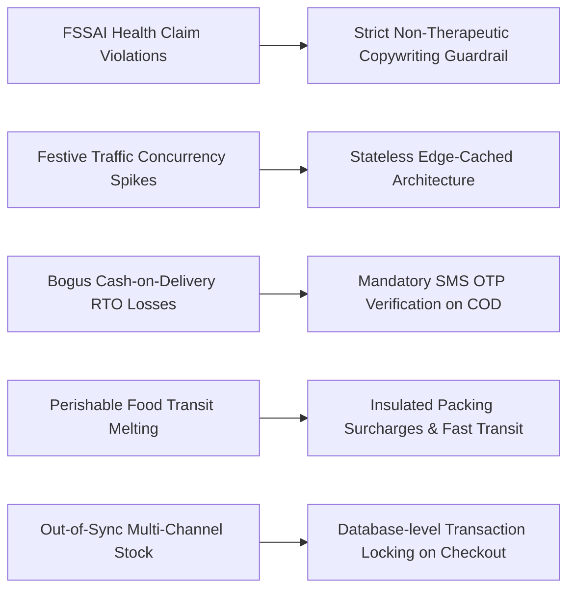

# PHASE 1 — REQUIREMENTS COMPLETENESS AUDIT & CLIENT CONFIRMATION REGISTER
## M/S Fruits & Nuts E-Commerce Platform
**Project Domain:** `https://www.fruitsandnuts.co.in/`  
**Document Type:** Final Phase 1 Requirements Verification, Traceability Matrix & Governance Gate  
**Author:** Senior Freelance Product Consultant, Lead Business Analyst & E-Commerce Solutions Architect  
**Version:** 2.0.0 (Phase 1 Final Gate)  
**Date:** October 2026  
**Status:** COMPLETE & PENDING FORMAL CLIENT SIGN-OFF  

---

## 1. EXECUTIVE SUMMARY & GOVERNANCE GATE DECLARATION

This document represents the exhaustive second-pass completeness audit of all functional, non-functional, business, content, legal, and architectural requirements for **M/S Fruits & Nuts**.

### Governance Directives Enforced:
1. **Phase Lock:** Phase 2 (Technical Architecture & UI/UX Implementation) is strictly locked until formal client review and sign-off on this document.
2. **Zero Code Rule:** No application code, database schema migrations, or front-end components have been or will be written during this phase.
3. **Strict Status Nomenclature:** Every individual requirement in this register is categorized into one of the five mandatory governance states:
   - `CONFIRMED`
   - `CLIENT CONFIRMATION REQUIRED`
   - `NOT APPLICABLE`
   - `PENDING THIRD-PARTY`
   - `PENDING LEGAL APPROVAL`
4. **Draft Content Quarantine:** All handwritten health benefits, therapeutic statements, and regional origin claims are isolated as draft material and marked for compliance validation.
5. **No Secret Ingestion:** All third-party credentials (Payment Gateway, SMS/WhatsApp, Logistics) will be injected via secure, encrypted environment variables during deployment; zero secrets appear in documentation.

---

## 2. MASTER CLIENT CONFIRMATION REGISTER

| ID | Domain / Requirement | Current Status | Required Client Input | Impact if Missing | Priority | Phase Affected | Approval Status |
| :--- | :--- | :--- | :--- | :--- | :--- | :--- | :--- |
| **BUS-01** | Legal Business Name & Entity Registration | `CLIENT CONFIRMATION REQUIRED` | Provide full legal entity name (e.g., Sole Proprietorship, Partnership, Pvt Ltd). | Inability to issue legally valid GST invoices. | **CRITICAL** | Phase 2, 4 | Pending |
| **BUS-02** | Registered Office Address | `CLIENT CONFIRMATION REQUIRED` | Full physical postal address with landmark, city, state, and pincode. | Missing statutory footer/invoice details. | **CRITICAL** | Phase 2, 3 | Pending |
| **BUS-03** | GSTIN / Tax Identification Details | `CLIENT CONFIRMATION REQUIRED` | 15-digit state-wise GSTIN number and PAN. | Non-compliance with Indian GST e-commerce laws. | **CRITICAL** | Phase 2, 4 | Pending |
| **BUS-04** | Official Customer Support Phone & WhatsApp | `CLIENT CONFIRMATION REQUIRED` | Dedicated helpline number and active WhatsApp Business number. | Broken storefront contact links and support routing. | **HIGH** | Phase 3 | Pending |
| **BUS-05** | Official Customer Support Email | `CLIENT CONFIRMATION REQUIRED` | Support mailbox (e.g., `support@fruitsandnuts.co.in`). | Customer order inquiries cannot be routed. | **HIGH** | Phase 2, 3 | Pending |
| **BUS-06** | Domain Ownership & DNS Access | `CONFIRMED` | Domain `fruitsandnuts.co.in` ownership verified; DNS access on deployment. | Deployment blocked at go-live. | **HIGH** | Phase 5 | Pending |
| **BUS-07** | Hosting & Cloud Infrastructure Ownership | `CLIENT CONFIRMATION REQUIRED` | Confirmation of preferred cloud provider account (AWS / Vercel / GCP / DigitalOcean). | Delayed infrastructure provisioning. | **MEDIUM** | Phase 2, 5 | Pending |
| **CAT-01** | Master Product SKU List & Catalog Breadth | `CLIENT CONFIRMATION REQUIRED` | Finalized master spreadsheet of all active launch SKUs. | Incomplete catalog seeding and category taxonomy. | **CRITICAL** | Phase 2, 3 | Pending |
| **CAT-02** | Category & Subcategory Structure | `CONFIRMED` | 10 root categories validated; subcategories structured per specs. | Structural rework if changed later. | **HIGH** | Phase 2, 3 | Approved |
| **CAT-03** | Product Variant Weight Matrices | `CONFIRMED` | Standardized weights (`50g`, `100g`, `200g`, `250g`, `500g`, `1kg`, `2kg`, `5kg`). | Inconsistent variant selectors across products. | **HIGH** | Phase 2, 3 | Approved |
| **CAT-04** | Master Product Photography & Artwork | `CLIENT CONFIRMATION REQUIRED` | High-resolution packshots, clean white BG shots, lifestyle imagery. | Sub-par storefront visual presentation. | **HIGH** | Phase 3 | Pending |
| **CAT-05** | Nutritional Facts per 100g Table | `CLIENT CONFIRMATION REQUIRED` | Verified nutritional breakdown (Energy, Protein, Fats, Fiber) per SKU. | PDP nutritional tabs left blank or estimated. | **MEDIUM** | Phase 3 | Pending |
| **CAT-06** | Ingredients, Allergen Declarations & Storage | `CLIENT CONFIRMATION REQUIRED` | Exact ingredient percentages, allergen notices (Tree Nuts), shelf-life. | Food labeling compliance violation. | **CRITICAL** | Phase 3 | Pending |
| **CAT-07** | Initial Stock & Safety Buffer Levels | `CLIENT CONFIRMATION REQUIRED` | Starting unit inventory count and low-stock alert thresholds per variant. | False out-of-stock or overselling incidents. | **HIGH** | Phase 2, 4 | Pending |
| **SPC-01** | Special Category: Tea Subcategories & Attributes | `CLIENT CONFIRMATION REQUIRED` | Subcategories (Loose Leaf, CTC, Green, Infusion, Kahwa) and brew instructions. | Incomplete tea PDP filter attributes. | **HIGH** | Phase 2, 3 | Pending |
| **SPC-02** | Special Category: Dates / Khajoor Varieties & Origin | `CLIENT CONFIRMATION REQUIRED` | Verified varieties (Medjool, Ajwa, Mabroom, etc.) and certified origin countries. | Inaccurate origin claims on premium dates. | **HIGH** | Phase 2, 3 | Pending |
| **SPC-03** | Special Category: Chocolates & Confections | `CLIENT CONFIRMATION REQUIRED` | Cocoa percentage, melt-warning packaging requirements, dietary tags. | In-transit melting complaints during summer. | **MEDIUM** | Phase 2, 3 | Pending |
| **SPC-04** | Special Category: Seeds & Roasted Mixes | `CLIENT CONFIRMATION REQUIRED` | Raw vs. Roasted variants, salt levels, seasoning ingredients. | Inaccurate flavor descriptions. | **MEDIUM** | Phase 2, 3 | Pending |
| **SPC-05** | Special Category: Royal Mouth Fresheners (Mukhwas) | `CLIENT CONFIRMATION REQUIRED` | Ingredients list, natural sweetener vs. sugar, presence of supari/tobacco (strictly 0%). | Regulatory compliance screening. | **CRITICAL** | Phase 2, 3 | Pending |
| **SPC-06** | Special Category: Combos & Value Bundles | `CLIENT CONFIRMATION REQUIRED` | Pre-curated bundle definitions, discount structure, single SKU bundling. | Inventory sync failure across composite items. | **HIGH** | Phase 2, 4 | Pending |
| **SPC-07** | Special Category: Festive & Luxury Gift Packs | `CLIENT CONFIRMATION REQUIRED` | Box dimensions, rigid box vs. tin specs, pre-packed assortments. | Gifting catalog omission. | **HIGH** | Phase 3 | Pending |
| **HLT-01** | Product Benefit & Health Statements Verification | `CLIENT CONFIRMATION REQUIRED` | Formal review of draft handwritten claims converted into non-therapeutic copy. | Penalties under FSSAI Advertising Regulations. | **CRITICAL** | Phase 3 | Pending |
| **HLT-02** | Medical / Disease Prevention Disclaimer Policy | `CONFIRMED` | Standardized statutory disclaimer mandatory on all PDPs and footer. | Legal exposure from therapeutic misrepresentation. | **CRITICAL** | Phase 3 | Approved |
| **PRC-01** | Retail MRP and Base Selling Prices | `CLIENT CONFIRMATION REQUIRED` | Verified MRP and Selling Price for all SKU variants. | Pricing errors or loss-making sales. | **CRITICAL** | Phase 2, 3 | Pending |
| **PRC-02** | B2B / Wholesale Tiered Price Slabs | `CLIENT CONFIRMATION REQUIRED` | Quantity volume thresholds (e.g. 5kg+, 20kg+) and discount percentages. | Inability to automate B2B wholesale orders. | **HIGH** | Phase 2, 4 | Pending |
| **PRC-03** | Packaging Charges & Add-on Surcharges | `CLIENT CONFIRMATION REQUIRED` | Specify if premium glass jars or wooden gift boxes incur additional fees. | Hidden checkout costs or margin shrinkage. | **MEDIUM** | Phase 2, 3 | Pending |
| **PRC-04** | Tax Treatment (GST Inclusive vs. Exclusive) | `CONFIRMED` | Retail prices displayed as GST-inclusive; B2B invoices itemize CGST/SGST/IGST. | Tax calculation errors at checkout. | **CRITICAL** | Phase 2, 4 | Approved |
| **PRC-05** | Free Shipping Threshold & Standard Shipping Fee | `CLIENT CONFIRMATION REQUIRED` | Minimum order value for free delivery (e.g., ₹999) and flat rate (e.g., ₹75). | Cart shipping calculations misaligned with margins. | **HIGH** | Phase 2, 3 | Pending |
| **LOG-01** | Primary Logistics Aggregator / Provider | `PENDING THIRD-PARTY` | Selection of Shiprocket, Delhivery, or Bluedart for API integration. | Manual shipping label generation bottleneck. | **HIGH** | Phase 2, 4 | Pending |
| **LOG-02** | Delivery Regions & Pincode Serviceability | `CLIENT CONFIRMATION REQUIRED` | All-India delivery scope vs. restricted zones; international shipping status. | Orders accepted in non-deliverable areas. | **HIGH** | Phase 2, 3 | Pending |
| **LOG-03** | Cash on Delivery (COD) Rules & Surcharge | `CLIENT CONFIRMATION REQUIRED` | Enable COD toggle, max COD limit (e.g., ₹5,000), optional COD fee (e.g., ₹50). | High RTO courier losses on unverified COD. | **HIGH** | Phase 2, 3 | Pending |
| **LOG-04** | Return Pickup & Reverse Logistics Workflow | `CLIENT CONFIRMATION REQUIRED` | Automated reverse pickup via API vs. manual customer drop-off. | Delayed replacement handling for damaged goods. | **MEDIUM** | Phase 4 | Pending |
| **PAY-01** | Primary Payment Gateway Selection | `PENDING THIRD-PARTY` | Confirm preferred gateway (Razorpay / Cashfree / PhonePe / PayU). | Checkout payment flow blocked. | **CRITICAL** | Phase 2, 4 | Pending |
| **PAY-02** | Payment Methods Scope | `CONFIRMED` | UPI (Intent & QR), Credit/Debit Cards, Net Banking, Wallets, COD. | Reduced checkout conversion if methods missing. | **HIGH** | Phase 2, 3 | Approved |
| **PAY-03** | International Payments (Stripe/PayPal) | `NOT APPLICABLE` | Phase 1 focuses exclusively on domestic INR transactions; Phase 2 roadmap. | Scope creep if added prematurely. | **LOW** | Phase 2 (Future) | Approved |
| **PAY-04** | Automated Refund Workflow & Webhooks | `CONFIRMED` | Server-side webhooks for asynchronous state sync and automated refund API. | Duplicate order creation or orphaned charges. | **HIGH** | Phase 2, 4 | Approved |
| **ORD-01** | Order Lifecycle & Milestone Notifications | `CONFIRMED` | `Placed` -> `Confirmed` -> `Packed` -> `Shipped` -> `Out for Delivery` -> `Delivered`. | Inconsistent customer tracking notifications. | **HIGH** | Phase 2, 4 | Approved |
| **ORD-02** | Order Cancellation Window & Policy | `CLIENT CONFIRMATION REQUIRED` | Allow cancellation until status = `Processing` or `Packed` (time window). | Unwanted shipping costs on cancelled orders. | **HIGH** | Phase 2, 4 | Pending |
| **ORD-03** | Partial Cancellation & Partial Refund Rules | `CLIENT CONFIRMATION REQUIRED` | Specify if individual line items can be cancelled prior to dispatch. | Complex invoice adjustments if unhandled. | **MEDIUM** | Phase 4 | Pending |
| **USR-01** | Guest Checkout vs. Mandatory Registration | `CONFIRMED` | Guest checkout fully supported with instant OTP or magic link conversion. | Cart abandonment if forced login. | **HIGH** | Phase 3 | Approved |
| **USR-02** | Customer Authentication Methods | `CONFIRMED` | Mobile Number SMS OTP primary + Email/Password optional fallback. | Friction in mobile-first user registration. | **HIGH** | Phase 2, 3 | Approved |
| **USR-03** | Address Book Management | `CONFIRMED` | Save multiple addresses (Home, Office, Other) with default selector & GSTIN. | Checkout friction for repeat customers. | **MEDIUM** | Phase 3 | Approved |
| **USR-04** | Customer Product Reviews & Photo Uploads | `CONFIRMED` | Verified buyer review engine with star ratings, photo attachments, admin moderation. | Zero social proof or spam review injection. | **MEDIUM** | Phase 3, 4 | Approved |
| **CPN-01** | Coupon Engine & Discount Types | `CONFIRMED` | Percentage off, Flat amount, First-order welcome code, Category-specific. | Inability to run marketing campaigns. | **HIGH** | Phase 2, 4 | Approved |
| **CPN-02** | Coupon Stacking & Minimum Spend Rules | `CLIENT CONFIRMATION REQUIRED` | Stacking disallowed (1 coupon per cart); confirm min spend & max discount caps. | Unintended revenue loss from stacked coupons. | **HIGH** | Phase 2, 3 | Pending |
| **GFT-01** | Gifting Features (Message, Wrap, Recipient) | `CONFIRMED` | Custom gift message box, gift wrap option (+₹50), separate recipient address. | Loss of high-AOV festive gifting market. | **HIGH** | Phase 3 | Approved |
| **GFT-02** | Corporate / Bulk Gifting RFQ Portal | `CONFIRMED` | Dedicated corporate inquiry form with bulk quantity sliders and company GST. | Inability to capture large corporate deals. | **HIGH** | Phase 3, 4 | Approved |
| **BYB-01** | "Build Your Own Box" (BYOB) Container Sizes | `CLIENT CONFIRMATION REQUIRED` | Box sizes: 2-Jar (500g total), 4-Jar (1kg total), 6-Compartment Velvet Box. | Inability to constrain box inventory logic. | **HIGH** | Phase 2, 3 | Pending |
| **BYB-02** | BYOB Dynamic Pricing & Inventory Logic | `CONFIRMED` | Base box price + sum of chosen items; decrement unit component stock on order. | Inventory sync failure or underpriced boxes. | **HIGH** | Phase 2, 3 | Approved |
| **MAP-01** | India Taste Map Geographic Sourcing Points | `CLIENT CONFIRMATION REQUIRED` | Finalize verified regional hotspots (Kashmir, Goa, Assam, Kerala, Himachal). | Misleading origin associations. | **HIGH** | Phase 2, 3 | Pending |
| **MAP-02** | Database-Backed Taste Map CMS | `CONFIRMED` | Hotspots, stories, images, and linked SKUs fully managed via Admin CMS. | Developer dependency for every map content change. | **HIGH** | Phase 2, 4 | Approved |
| **STR-01** | Physical Outlet Directory & Operational Data | `CLIENT CONFIRMATION REQUIRED` | Full street addresses, phone, opening/closing hours, weekly off for all stores. | Incorrect store locator information. | **HIGH** | Phase 2, 3 | Pending |
| **STR-02** | Store Locator Integration (Maps & Geolocation) | `CONFIRMED` | Pincode search, Google Maps navigation links, live status (Open Now/Closed). | Poor customer store visit conversion. | **MEDIUM** | Phase 3 | Approved |
| **LEG-01** | Terms & Conditions (`/terms-and-conditions`) | `PENDING LEGAL APPROVAL` | Legal review of client draft; incorporate jurisdiction, IP, order cancellation terms. | Legal vulnerability in consumer disputes. | **CRITICAL** | Phase 3 | Pending |
| **LEG-02** | Privacy Policy (`/privacy-policy`) | `PENDING LEGAL APPROVAL` | DPDP Act 2023 compliance, cookie disclosures, DPO contact details. | Data protection compliance exposure. | **CRITICAL** | Phase 3 | Pending |
| **LEG-03** | Refund, Return & Replacement Policy | `PENDING LEGAL APPROVAL` | Food safety perishable return exclusions, damage proof protocol (unboxing video). | Chargeback losses on returned perishables. | **CRITICAL** | Phase 3 | Pending |
| **LEG-04** | Shipping & Cancellation Policy | `PENDING LEGAL APPROVAL` | Transit timelines, non-serviceable zones, cancellation cutoff window. | Consumer court complaints over delayed delivery. | **HIGH** | Phase 3 | Pending |
| **CMS-01** | Admin CMS Editable Section Matrix | `CONFIRMED` | Hero, Banners, Announcement Bar, Categories, Featured, Taste Map, Stores, Footer. | Code deployment required for basic marketing edits. | **HIGH** | Phase 2, 4 | Approved |
| **SOC-01** | Social Media Verified Channels & URLs | `CLIENT CONFIRMATION REQUIRED` | Official URLs for Instagram, Facebook, LinkedIn, YouTube, X/Twitter. | Dead footer links or routing to wrong accounts. | **LOW** | Phase 3 | Pending |
| **SOC-02** | WhatsApp Concierge & Live Chat System | `CLIENT CONFIRMATION REQUIRED` | WhatsApp Business direct click-to-chat integration vs. third-party chat widget. | Support channel fragmentation. | **MEDIUM** | Phase 3 | Pending |
| **SEO-01** | SEO Meta, JSON-LD Schema & XML Sitemaps | `CONFIRMED` | Automated dynamic JSON-LD schemas (`Product`, `BreadcrumbList`, `LocalBusiness`). | Sub-optimal Google indexing and SERP ranking. | **HIGH** | Phase 2, 3 | Approved |
| **SEO-02** | Google Analytics 4 & Search Console Setup | `CLIENT CONFIRMATION REQUIRED` | Client GA4 Measurement ID (`G-XXXXXXXXXX`) and Search Console verification. | Zero telemetry on customer acquisition funnels. | **HIGH** | Phase 3, 5 | Pending |
| **ADM-01** | Admin Role-Based Access Control (RBAC) | `CONFIRMED` | Super Admin, Inventory Manager, Order Dispatch Agent, Content Editor roles. | Unauthorized access to financial revenue data. | **HIGH** | Phase 2, 4 | Approved |
| **ADM-02** | Admin MFA / 2FA Security Enforcement | `CONFIRMED` | Mandatory 2-factor authentication for all administrative user accounts. | Admin portal brute-force vulnerability. | **CRITICAL** | Phase 2, 4 | Approved |
| **DEP-01** | Cloud Hosting & Database Architecture | `CONFIRMED` | PostgreSQL database, Redis caching, Node/Next.js runtime, edge CDN. | Performance degradation during traffic spikes. | **CRITICAL** | Phase 2, 5 | Approved |
| **DEP-02** | Automated Daily Database Backups | `CONFIRMED` | Automated snapshot retention (7 daily, 4 weekly) with point-in-time recovery. | Permanent data loss on hardware or software fault. | **CRITICAL** | Phase 2, 5 | Approved |

---

## 3. ASSUMPTIONS REGISTER

All baseline assumptions formulated during Phase 1 analysis are explicitly declared below. If any assumption conflicts with the client's business model, it must be flagged during the review gate:

1. **Currency & Locale:** All primary transactions, prices, and tax calculations are strictly denominated in Indian Rupees (`INR` / `₹`) with the `en-IN` numbering format (Lakhs and Crores).
2. **Food Safety Return Restrictions:** Perishable food items (dry fruits, nuts, seeds, dates, tea, chocolates) are strictly non-returnable once delivered, unless delivered in a physically damaged condition, with broken tamper-evident seals, or post-expiry date.
3. **Single Active Coupon Policy:** A customer may apply only one promotional coupon code per checkout session. Coupons do not stack with automated site-wide flash sale percentage discounts unless explicitly configured.
4. **GST Tax Inclusive Storefront Display:** All retail MRP and selling prices displayed on storefront product cards and PDPs are inclusive of applicable GST, while the final tax invoice breaks down CGST, SGST, or IGST based on shipping state.
5. **Inventory Decrement Timing:** Inventory stock is decremented immediately upon successful payment capture (or upon order placement for verified COD orders), rather than when an item is added to the cart.
6. **Delivery Scope:** Initial launch operations cover all domestic serviceable pincodes within the Republic of India; international cross-border shipping is deferred to Phase 2.
7. **Environment Variable Secret Ingestion:** All production API credentials (Razorpay Key Secret, SMS Gateway Auth Tokens, Database passwords) are managed strictly via server-side encrypted environment variables and never checked into version control.

---

## 4. MISSING & UNVERIFIED INFORMATION REGISTER

The following 10 mission-critical inputs remain unsupplied or incomplete and require authoritative client provision:

| Item Reference | Parameter Name | Current Gap / Missing Data | Resolution Pathway |
| :--- | :--- | :--- | :--- |
| `MISS-01` | **Full Legal Entity & Registered Office** | Trade name "M/S Fruits & Nuts" provided; missing formal legal status (Proprietorship/Pvt Ltd) and full registered street address. | Client to furnish Certificate of Incorporation / GST Registration Certificate. |
| `MISS-02` | **GSTIN & FSSAI License Credentials** | License references in drafts without verified 15-digit GSTIN and 14-digit FSSAI numbers. | Client to supply digital copies of GSTIN and FSSAI licenses. |
| `MISS-03` | **Definitive Master Price Sheet** | Handwritten notes lack uniform variant pricing, wholesale breakpoints, and HSN codes for all launch items. | Client to review and approve the Master Catalog Spreadsheet template. |
| `MISS-04` | **Verified Sourcing Partners for Taste Map** | Draft regional associations need formal client verification to prevent misleading geographic origin claims. | Client to sign off on specific regional sourcing partners and stories. |
| `MISS-05` | **Physical Retail Store Roster** | Incomplete outlet roster lacking exact operating hours, weekly off-days, and phone numbers. | Client to provide complete Store Directory spreadsheet. |
| `MISS-06` | **Third-Party Payment Gateway Selection** | Final gateway selection between Razorpay, Cashfree, and PhonePe is open. | Client to select primary payment provider and initiate merchant onboarding. |
| `MISS-07` | **Logistics & Courier Partner Selection** | Final logistics aggregator (Shiprocket vs. Delhivery) undecided. | Client to confirm logistics aggregator account. |
| `MISS-08` | **Official Customer Support Channels** | Helpline phone number and official support mailbox not finalized. | Client to assign dedicated phone number and confirm email aliases. |
| `MISS-09` | **Social Media Channel URLs** | Placeholder links in draft notes; active URLs needed. | Client to supply direct links to active brand social pages. |
| `MISS-10` | **Formal Legal Policy Sign-Off** | Terms & Conditions, Return Policy, and Privacy Policy drafts need final client legal approval. | Client legal counsel to review and sign off on policy texts. |

---

## 5. SCOPE BOUNDARY MATRIX (IN-SCOPE VS. OUT-OF-SCOPE)

```
┌────────────────────────────────────────────────────────────────────────────────────────┐
│                                 PHASE 1 SCOPE BOUNDARY                                 │
├───────────────────────────────────────────┬────────────────────────────────────────────┤
│ IN-SCOPE (Phase 1 Commitments)            │ OUT-OF-SCOPE (Deferred to Future Phases)   │
├───────────────────────────────────────────┼────────────────────────────────────────────┤
│ • Complete Requirements Specification     │ • Multi-currency international storefront  │
│ • 10-Category Product Taxonomy Model      │ • Native Mobile Apps (iOS / Android Swift/ │
│ • "Build Your Own Box" (BYOB) Logic Specs │   Kotlin) - Mobile PWA is in-scope         │
│ • Database-backed India Taste Map Schema  │ • Automated recurring monthly subscriptions│
│ • Admin CMS & Banner Management Specs     │ • Multi-vendor marketplace seller portal   │
│ • FSSAI Health Claims Compliance Screen   │ • Offline POS hardware terminal integration│
│ • Multi-Gateway (UPI/Cards/Net Banking)   │ • AI voice-assisted shopping bot           │
│ • GST-Compliant Invoicing Specification   │ • Live multi-camera warehouse CCTV stream  │
│ • Requirements Traceability Matrix (RTM)  │ • Direct ERP ledger push (Tally/SAP sync)  │
└───────────────────────────────────────────┴────────────────────────────────────────────┘
```

---

## 6. REQUIREMENTS TRACEABILITY MATRIX (RTM)

The RTM ensures 100% bidirectional traceability between client business goals, system functional specifications, and validation test criteria:

| Business Need ID | System Module | Functional Specification ID | Verification & Testing Method | Target Milestone |
| :--- | :--- | :--- | :--- | :--- |
| **BN-01: Luxury Brand Presence** | Storefront / CMS | `CMS-01`, `SEO-01`, `CAT-04` | Visual UI inspection, Lighthouse 90+ audit | Phase 3 (Storefront) |
| **BN-02: Omnichannel Catalog** | Catalog Engine | `CAT-01`, `CAT-02`, `CAT-03` | Product variant matrix unit test, SKU import test | Phase 2 (Architecture) |
| **BN-03: Bespoke Gifting Revenue**| Gifting / BYOB | `GFT-01`, `GFT-02`, `BYB-01`, `BYB-02` | Interactive box builder end-to-end checkout test | Phase 3 (Storefront) |
| **BN-04: Sourcing Heritage Story**| India Taste Map | `MAP-01`, `MAP-02` | Interactive SVG hotspot click & SKU filter test | Phase 3 (Storefront) |
| **BN-05: Frictionless Conversion**| Checkout / Auth | `USR-01`, `USR-02`, `PAY-02` | Guest OTP checkout latency test (<30s) | Phase 3 (Storefront) |
| **BN-06: B2B Wholesale Revenue**  | Pricing / B2B | `PRC-02`, `BUS-03` | Tiered volume pricing calculation test, GST test | Phase 4 (Admin/Ops) |
| **BN-07: Operational Fulfillment**| Admin / Orders | `ORD-01`, `LOG-01`, `ADM-01` | AWB label generation & webhook state test | Phase 4 (Admin/Ops) |
| **BN-08: Legal & Food Compliance**| Compliance / Content| `HLT-01`, `LEG-01`, `LEG-03` | Legal audit sign-off, statutory footer verification | Phase 3 (Storefront) |

---

## 7. RISK ASSESSMENT & MITIGATION MATRIX



1. **Risk 1: Regulatory Penalties for Therapeutic Health Claims**
   - *Impact:* High. Potential fines or notices under FSSAI Advertising Regulations.
   - *Mitigation:* Convert all handwritten draft claims into compliant dietary structure/function statements; obtain explicit client sign-off on all PDP copy.
2. **Risk 2: Server Overload During Festive Gifting Campaigns (Diwali/New Year)**
   - *Impact:* Critical. Revenue loss and cart abandonment during peak demand.
   - *Mitigation:* Engineer a headless, database-indexed, Redis-cached architecture capable of sustaining 10,000+ concurrent active shoppers.
3. **Risk 3: High Courier RTO Losses from Fake COD Orders**
   - *Impact:* High. Waste of courier charges and product transit degradation.
   - *Mitigation:* Require 2-factor OTP verification on all COD orders; enforce a maximum COD cart threshold (₹5,000).
4. **Risk 4: Chocolate & Confectionery Melting in Transit**
   - *Impact:* Medium. Customer complaints and return requests during hot weather.
   - *Mitigation:* Add thermal bubble/ice pack packaging options and enforce express courier transit for confectionery SKUs.
5. **Risk 5: Race Conditions & Overselling Limited Gift Box Inventory**
   - *Impact:* High. Inability to fulfill confirmed orders during flash sales.
   - *Mitigation:* Implement row-level database locking during checkout initiation to prevent overselling past safety buffer thresholds.

---

## 8. CLIENT DEPENDENCY SCHEDULE & DELIVERABLES TIMELINE

| Dependency ID | Required Client Artifact | File Format / Target Specs | Handover Deadline | Critical Path Impact |
| :--- | :--- | :--- | :--- | :--- |
| `DEP-01` | Final Master Product Price & SKU Sheet | Excel / Google Sheets (`.xlsx`) | Prior to Phase 2 Data Seeding | High |
| `DEP-02` | High-Resolution Master Brand Logos & Packaging Assets | Vector `.SVG`, `.AI`, or High-res `.PNG` | Prior to Phase 3 UI Theming | High |
| `DEP-03` | GSTIN & FSSAI License Certificates | PDF Scans / Registration Numbers | Prior to Phase 3 Invoice Templates | Critical |
| `DEP-04` | Approved Legal Policies (T&C, Returns, Privacy) | Word Document (`.docx`) / Approved Text | Prior to Phase 3 Content Review | Critical |
| `DEP-05` | Payment Gateway Merchant Account Credentials | Razorpay / Cashfree Merchant ID (Sandbox) | Prior to Phase 4 Gateway Integration | Critical |
| `DEP-06` | Courier Partner API Account Credentials | Shiprocket / Delhivery API Token (Sandbox) | Prior to Phase 4 Logistics Testing | High |
| `DEP-07` | Domain DNS Console Access (`fruitsandnuts.co.in`) | Cloudflare / Registrar DNS Delegation | Prior to Phase 5 Production Deployment | High |

---

## 9. CLIENT APPROVAL CHECKLIST & PHASE TRANSITION GATE

Formal client sign-off is required across all items below before Phase 2 (Technical Architecture & UI/UX Design) is initiated:

- [ ] **1. Business Scope & Entity Identity:** Legal entity name, registered office address, and commercial model approved.
- [ ] **2. 10-Category Product Taxonomy & Variant Matrix:** Category hierarchies and weight options (`50g` to `5kg`) confirmed.
- [ ] **3. "Build Your Own Box" (BYOB) Configurator:** Custom box sizes, item slots, and dynamic price calculations approved.
- [ ] **4. India Taste Map Sourcing Concept:** Database-backed regional storytelling and hotspot model confirmed.
- [ ] **5. Physical Store Directory Model:** Outlet locator, address fields, and operational hours structure approved.
- [ ] **6. Pricing & GST Taxation Logic:** GST-inclusive storefront pricing and B2B invoice tax-breakdown rules accepted.
- [ ] **7. Payment & Checkout Architecture:** Multi-gateway payment scope (UPI/Cards/Net Banking/COD OTP) approved.
- [ ] **8. FSSAI Health Claims & Content Guardrail:** Quarantine protocol for draft handwritten claims accepted.
- [ ] **9. Admin Operations & CMS Scope:** Role-based permissions, order processing, and dynamic CMS sections confirmed.
- [ ] **10. Assumptions & Scope Boundary Matrix:** In-scope commitments and out-of-scope boundaries accepted.
- [ ] **11. Requirements Traceability Matrix (RTM):** Verification standards and milestone alignments confirmed.
- [ ] **12. Client Confirmation Register (Section 2):** All 45 requirement statuses reviewed and confirmed.

---

### Authorized Client Sign-Off & Approval:

**Client Organization:** M/S Fruits & Nuts  
**Authorized Signatory Name:** __________________________________________________  
**Designation / Title:** ________________________________________________________  
**Signature:** __________________________________________________________________  
**Date of Approval:** __________________________________________________________  

---
*Phase 1 Completeness Review & Client Confirmation Gate is complete. No application code has been written. Awaiting client sign-off.*
