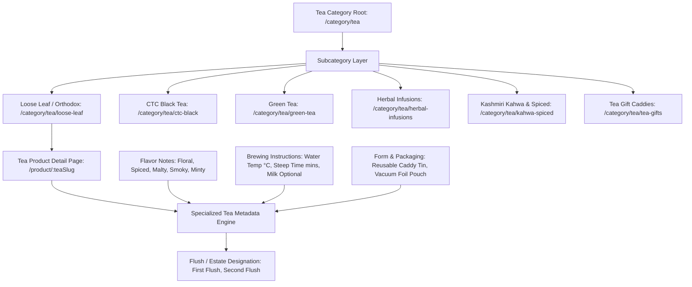
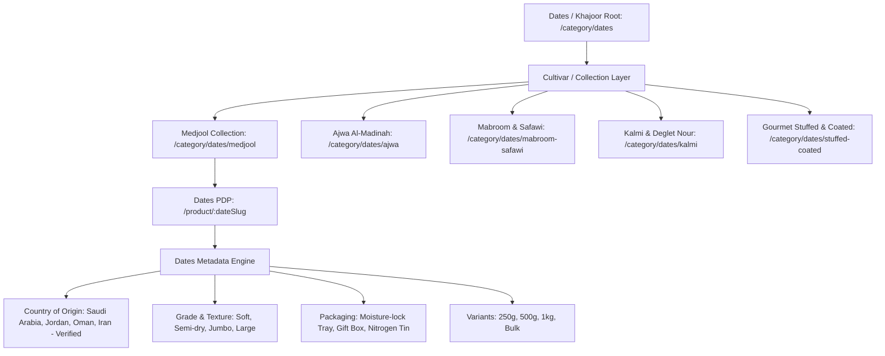
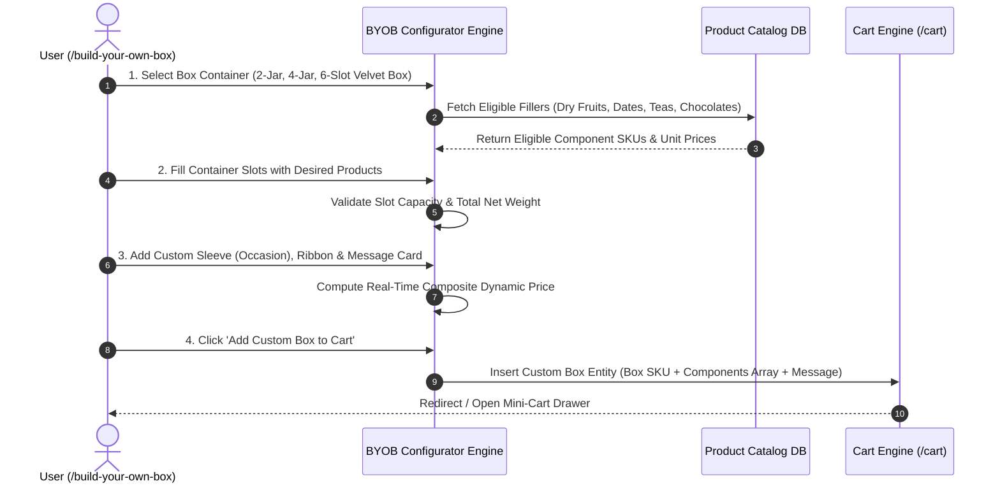
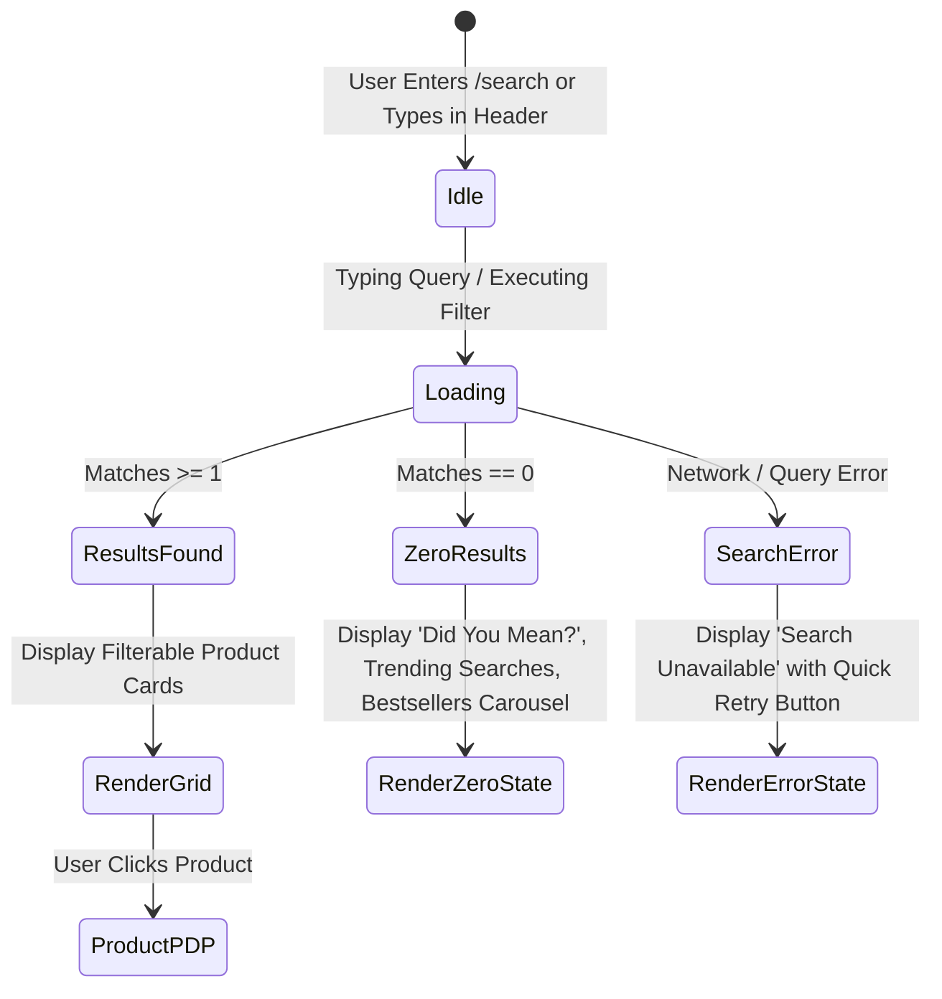

# SITEMAP & INFORMATION ARCHITECTURE (IA) SPECIFICATION
## M/S Fruits & Nuts — Premium E-Commerce Platform
**Document Version:** 1.0.0 (Phase 3 Final Architecture)  
**Status:** COMPLETE & VERIFIED  
**Domain:** `https://www.fruitsandnuts.co.in/`  
**Author:** Senior Freelance Product Consultant, Lead Business Analyst & E-Commerce Solutions Architect  

---

## 1. SOURCE OF TRUTH & ARCHITECTURAL FOUNDATIONS

This Information Architecture (IA) and Sitemap Specification translates all business, functional, and technical specifications established in:
- **Phase 1:** Client Requirements Document (`CLIENT_REQUIREMENTS_DOCUMENT.md` & `PHASE_1_FINAL_TRACEABILITY_AND_SIGN_OFF_MATRIX.md`)
- **Phase 2:** Product Requirements Document (`PRODUCT_REQUIREMENTS_DOCUMENT.md`)

### Core Architecture Governance Rules:
1. **Zero Hardcoding of Client Content:** All category names, subcategories, product varieties, origin stories, prices, box dimensions, and store locations are represented as dynamic, database-backed, CMS-controlled entities.
2. **Provider-Agnostic Abstraction:** Payment endpoints reference generic checkout routing (`PAYMENT_PROVIDER_PENDING`), and shipping tracking references abstract logistics adapters (`LOGISTICS_PROVIDER_PENDING`).
3. **Draft Health Claims Quarantine:** Product routes isolate draft wellness claims into configurable CMS containers requiring client and compliance clearance.
4. **Taste Map Boundaries:** The `/taste-map` route connects verified regions, stories, and linked SKUs without assuming unverified "sourcing partners".
5. **No Code Implementation:** No frontend application code, database migrations, backend APIs, or payment SDKs are implemented in this phase.

---

## 2. COMPLETE CUSTOMER-FACING SITEMAP

```
PUBLIC STOREFRONT SITEMAP (https://www.fruitsandnuts.co.in)
│
├── / (Homepage / Flagship Landing)
│
├── 1. CATALOG & DISCOVERY ROUTES
│   ├── /shop (All Products / Universal Catalog View)
│   ├── /search (Global Search & Faceted Discovery)
│   ├── /category/:categorySlug (Root Category PLP - e.g., /category/dry-fruits)
│   │   └── /category/:categorySlug/:subcategorySlug (Subcategory PLP - e.g., /category/dry-fruits/almonds)
│   ├── /collection/:collectionSlug (Curated Collections - e.g., /collection/bestsellers, /collection/immunity-boosters)
│   └── /product/:productSlug (Product Detail Page - Dynamic Variant Matrix)
│
├── 2. SPECIALTY & SIGNATURE EXPERIENCES
│   ├── /gifting (Gifting Hub & Occasion Collections)
│   │   ├── /gifting/festive (Festival Hampers - Diwali, Eid, New Year)
│   │   ├── /gifting/corporate (Corporate Hampers & Bulk Inquiry Portal)
│   │   └── /gifting/occasions (Wedding, Birthday, Anniversary Collections)
│   ├── /gift-packs (Pre-assembled Luxury Gift Boxes & Tins)
│   ├── /build-your-own-box (Interactive "Build Your Own Box" / BYOB Configurator)
│   ├── /taste-map ("The Taste Map of India" Interactive Regional Discovery)
│   │   └── /taste-map/:regionSlug (Dedicated Regional Sourcing Story & Curated SKUs)
│   └── /stores (Physical Retail Store Directory & Interactive Outlets Locator)
│
├── 3. CART & CHECKOUT FUNNEL
│   ├── /cart (Shopping Cart Drawer & Full Cart Review)
│   └── /checkout (Single-Page Accelerated Checkout)
│       ├── /checkout/address (Shipping & Billing Details)
│       ├── /checkout/payment (Provider-Agnostic Payment Screen - PAYMENT_PROVIDER_PENDING)
│       ├── /checkout/success/:orderId (Order Confirmation & Receipt)
│       └── /checkout/failed/:orderId (Payment Retry & Assistance)
│
├── 4. CUSTOMER AUTHENTICATION & SELF-SERVICE
│   ├── /login (Mobile OTP Login / Password Authentication)
│   ├── /register (Customer Account Creation)
│   ├── /forgot-password (Password Recovery & Verification)
│   └── /account (Customer Account Dashboard)
│       ├── /account/profile (Personal Details & Contact Preferences)
│       ├── /account/addresses (Address Book Management + GSTIN)
│       ├── /account/orders (Order History & Live Status Ledger)
│       │   ├── /account/orders/:orderId (Order Details, Itemized Invoice PDF)
│       │   └── /account/orders/:orderId/track (Consignment Tracking - LOGISTICS_PROVIDER_PENDING)
│       ├── /account/wishlist (Saved Items & Move to Cart)
│       ├── /account/reviews (Submitted Reviews & Pending Review Invitations)
│       └── /account/settings (Security, Password Change, Notification Preferences)
│
└── 5. CORPORATE, INFORMATIONAL & COMPLIANCE
    ├── /about (The Heritage & Gourmet Story of M/S Fruits & Nuts)
    ├── /contact (Customer Support, Contact Form, WhatsApp Concierge)
    ├── /faq (Frequently Asked Questions: Ordering, Shipping, Quality, Returns)
    ├── /terms-and-conditions (Dedicated Statutory Terms & Conditions Page)
    ├── /privacy-policy (Data Protection & DPDP Act 2023 Compliance)
    ├── /shipping-policy (Delivery Timelines, Rates, Pincode Policies)
    ├── /return-policy (Return, Refund & Perishable Food Replacement Policy)
    └── /cancellation-policy (Order Cancellation Window & Guidelines)
```

---

## 3. PRODUCT CATEGORY HIERARCHY & TAXONOMY

The platform supports a scalable 5-level entity taxonomy:
$$\text{Category} \longrightarrow \text{Subcategory} \longrightarrow \text{Collection} \longrightarrow \text{Product (Master SKU)} \longrightarrow \text{Product Variant (SKU-Weight)}$$

```
PRODUCT TAXONOMY TREE
│
├── 1. Fruits & Nuts
│   ├── Raw / Natural Nuts (Almonds, Cashews, Walnuts, Pistachios, Hazelnuts, Macadamias)
│   ├── Roasted & Salted Nuts
│   └── Flavored Gourmet Nuts (Smoked BBQ, Peri-Peri, Cream & Onion, Saffron Infused)
│
├── 2. Dry Fruits
│   ├── Almonds (Mamra, California, Gurbandi)
│   ├── Cashews (Jumbo W180, W240, W320, Split)
│   ├── Walnuts (Snow White Kernels, In-Shell Walnuts)
│   ├── Pistachios (Roasted Salted, Green Pista Kernels)
│   ├── Raisins / Kishmish (Green, Black, Golden Jumbo)
│   ├── Figs / Anjeer (Turkish Jumbo, Afghan Figs)
│   └── Berries & Prunes (Cranberries, Blueberries, Dried Apricots, Pitted Prunes)
│
├── 3. Dates / Khajoor
│   ├── Premium Cultivars (Medjool, Ajwa, Mabroom, Safawi, Kalmi)
│   ├── Stuffed Gourmet Dates (Almond Stuffed, Orange Peel Stuffed, Walnut Stuffed)
│   └── Chocolate Dipped Dates
│
├── 4. Super Seeds & Edible Kernels
│   ├── Raw Single Varietals (Chia Seeds, Flax Seeds, Pumpkin Seeds, Sunflower Seeds, Watermelon Seeds)
│   └── Roasted Superfood Mixes (7-in-1 Omega Mix, Salted Roasted Pumpkin & Flax)
│
├── 5. Artisan Tea Collection
│   ├── Orthodox & Loose Leaf (First Flush Darjeeling, Assam Orthodox)
│   ├── CTC Black Teas (Masala Chai, Cardamom Infused, Royal CTC)
│   ├── Green Teas (Pure Himalayan Green, Jasmine Green, Kashmiri Kahwa)
│   └── Herbal & Wellness Infusions (Chamomile, Hibiscus Rose, Turmeric Ginger)
│
├── 6. Gourmet Chocolates & Confections
│   ├── Artisan Dark Chocolate Bars (55%, 70%, 85% Single-Origin Cocoa)
│   ├── Nut Clusters & Dragées (Chocolate Almond Dragées, Hazelnut Pralines)
│   └── Chocolate Dipped Dry Fruits
│
├── 7. Royal Mouth Fresheners (Mukhwas)
│   ├── Heritage Paan Confections (Calcutta Meetha Paan, Royal Paan Mix - 0% Tobacco)
│   ├── Roasted Digestive Seeds & Fennel (Silver-coated Cardamom, Roasted Saunf Mix)
│   └── Amla & Fruit Digestives
│
├── 8. Value Combos & Daily Nutrition Packs
│   ├── Daily Health Packs (Student Pack, Fitness High-Protein Pack, Senior Care Pack)
│   └── Multi-pack Bundles (Dry Fruit Triple Treat, Seed Trio)
│
├── 9. Gift Packs & Luxury Hampers
│   ├── Classic Wooden Keepsake Boxes
│   ├── Royal Velvet Presentation Trays
│   ├── Heritage Metal Tin Hampers
│   └── "Build Your Own Box" (BYOB) Configurable Boxes
│
└── 10. Specialty & Allied Products
    ├── Saffron (Grade-A Kashmiri Kesar)
    ├── Organic Honey & Nut Butters
    └── Cold-Pressed Nut Oils
```

---

## 4. TEA INFORMATION ARCHITECTURE

The Tea category incorporates specialized brewing and flavor taxonomy:



*(Launch availability of individual tea subcategories remains configurable via Admin CMS).*

---

## 5. DATES / KHAJOOR INFORMATION ARCHITECTURE

The Dates category structure supports origin verification and cultivar attributes:



*(No geographic origin or cultivar is hardcoded; all data is populated via verified catalog inputs).*

---

## 6. GIFTING & OCCASION INFORMATION ARCHITECTURE

```
GIFTING HUB (/gifting)
│
├── 1. Occasion Collections
│   ├── Festive Celebrations (/gifting/festive) -> Diwali, Eid, New Year, Raksha Bandhan
│   ├── Corporate & Executive Hampers (/gifting/corporate) -> Bulk RFQ Portal, Custom Branding
│   ├── Wedding & Trousseau Assortments (/gifting/wedding) -> Luxury Wooden/Velvet Boxes
│   ├── Birthday & Anniversary (/gifting/birthday, /gifting/anniversary) -> Personalized Greetings
│   └── Thank You & Wellness Hampers (/gifting/wellness) -> Immunity & Nutrition Curations
│
├── 2. Packaging Formats (/gift-packs)
│   ├── Handcrafted Wooden Treasure Boxes
│   ├── Regal Velvet & Satin Compartment Trays
│   ├── Artisanal Embossed Tin Canisters
│   └── Eco-Friendly Jute & Cotton Potlis
│
└── 3. Bespoke Customization
    └── Interactive "Build Your Own Box" Configurator (/build-your-own-box)
```

---

## 7. "BUILD YOUR OWN BOX" (BYOB) ARCHITECTURE



### Route & System Relationships:
- **Primary Route:** `/build-your-own-box`
- **Data Dependency:** Dynamic filtering query for eligible component SKUs (`is_byob_eligible = true`).
- **Cart Representation:** Stored as a composite bundle line-item referencing the container SKU and an array of selected child SKUs.
- **Inventory Synchronization:** Locks 1 unit of container inventory and 1 unit of each selected child variant upon order confirmation.

---

## 8. SEARCH & DISCOVERY ARCHITECTURE

```
/search
│
├── Query Engine: ?q=:searchQuery
├── Active Facet Filters: &category=:catSlug&minPrice=:min&maxPrice=:max&weight=:wt&diet=:tag
└── Sort Engine: &sort=featured|price-asc|price-desc|rating|newest
```

### Search State Flow:



---

## 9. CUSTOMER ACCOUNT INFORMATION ARCHITECTURE

```
/account (Protected Route - Customer Auth Guard)
│
├── /account/profile
│   ├── Personal Details (Name, Mobile, Email, DOB)
│   └── Marketing Communication Preferences (SMS, WhatsApp, Email Opt-in)
│
├── /account/addresses
│   ├── Saved Address Cards (Default Shipping, Default Billing, Other)
│   ├── Add New Address Modal (Pincode Autocomplete, Street, Landmark)
│   └── Optional B2B GSTIN & Company Name Entry
│
├── /account/orders
│   ├── Filter by Status (All, Active, Delivered, Cancelled)
│   ├── Order Summary Card (Order ID, Date, Total Amount, Items Thumbnails)
│   └── /account/orders/:orderId (Deep Details View)
│       ├── Itemized Line-Item Table
│       ├── Price Breakdown (Subtotal, GST Split, Shipping, Coupon Discount)
│       ├── Delivery Timeline Progress Bar
│       ├── Download Tax Invoice (PDF)
│       ├── /account/orders/:orderId/track (Consignment Tracking - LOGISTICS_PROVIDER_PENDING)
│       └── Initiate Return / Replacement (For Damaged Food Goods within Policy TAT)
│
├── /account/wishlist
│   ├── Saved Products Grid with Live Stock Status
│   └── One-Click "Move to Cart" Action
│
├── /account/reviews
│   ├── Published Reviews Ledger
│   └── Pending Review Invitations for Purchased Products
│
└── /account/settings
    ├── Password Update (For Email/Password Users)
    ├── Active Login Sessions
    └── /logout (Session Destruction & Redirect to Homepage)
```

---

## 10. CHECKOUT FUNNEL ARCHITECTURE

```mermaid
flowchart LR
    Cart[/cart] --> CheckAuth{User Logged In?}
    CheckAuth -->|Yes| Step1[/checkout: Address Selection]
    CheckAuth -->|No| GuestAuth[/checkout: Guest Mobile OTP / Login]
    GuestAuth --> Step1
    
    Step1 --> Step2[/checkout: Delivery & Billing Review]
    Step2 --> Step3[/checkout: Coupon & Gifting Add-ons]
    Step3 --> Step4[/checkout: Payment Method Selection]
    
    Step4 --> GatewayAuth{PAYMENT_PROVIDER_PENDING}
    GatewayAuth -->|Success| SuccessRoute[/checkout/success/:orderId]
    GatewayAuth -->|Failure / Cancel| FailureRoute[/checkout/failed/:orderId]
    FailureRoute -->|Retry Payment| Step4
```

- **Data Integrity:** All calculations (subtotal, shipping fee, tax, discounts) are strictly validated on the server prior to generating the payment token.

---

## 11. ORDER & FULFILLMENT ARCHITECTURE

```
ORDER ROUTING & ACCESS CONTROL
│
├── Customer-Facing Order Routes (Requires User Session or Verified Order Token)
│   ├── /account/orders (Customer Order History Ledger)
│   ├── /account/orders/:orderId (Itemized Order Summary & Invoice PDF)
│   ├── /account/orders/:orderId/track (Consignment Tracking)
│   └── /order/guest-track (Public PNR-style lookup: Order ID + Phone OTP)
│
└── Internal Order Processing (Admin Only - Public Access Strictly Forbidden)
    ├── /admin/orders (Master Order Processing Queue)
    ├── /admin/orders/:orderId (Order Fulfillment, State Transition, AWB Print)
    └── /admin/orders/:orderId/invoice (GST Tax Invoice PDF Generator)
```

---

## 12. "THE TASTE MAP OF INDIA" INFORMATION ARCHITECTURE

```
/taste-map ("The Taste Map of India")
│
├── Interactive SVG India Map Component
│   ├── Regional Hotspots (Vector Pin Coordinates)
│   └── Region Hover / Tap State (Preview Card: Region Name & Signature Harvest)
│
└── /taste-map/:regionSlug (Dedicated Regional Deep-Dive Route)
    ├── Regional Sourcing Narrative & Agricultural Heritage Story
    ├── Regional Photography Banner
    ├── Authoritative Source / Verification Documentation
    └── Curated Regional Product Grid (Direct "Add to Cart" Actions)
```

*(All regional hotspots, stories, and linked SKUs are fetched dynamically from the database and managed via Admin CMS).*

---

## 13. PHYSICAL STORE LOCATIONS ARCHITECTURE

```
/stores (Store Directory & Outlets Locator)
│
├── City / State Filter & Search Bar
├── "Use Current Location" Geolocation Trigger
├── Interactive Map Embed (Google Maps / MapmyIndia Markers)
└── Store Cards List
    ├── Outlet Name & Status Badge (Open Now / Closed / Coming Soon)
    ├── Full Physical Street Address
    ├── Contact Telephone & WhatsApp Link
    ├── Operating Hours (Opening, Closing, Weekly Off)
    └── "Get Directions" Navigation CTA (Launches Google Maps)
```

---

## 14. ADMIN & CMS SITEMAP (PROTECTED CONSOLE)

```
ADMIN MANAGEMENT CONSOLE (/admin/*) — Requires Role-Based Auth & 2FA
│
├── /admin (Redirects to Dashboard)
├── /admin/dashboard (Sales Telemetry, Orders Velocity, AOV, Low Stock Alerts)
│
├── /admin/catalog (Catalog Management Hub)
│   ├── /admin/products (Product Master Ledger)
│   ├── /admin/products/new (Create New Product & Variant Matrix)
│   ├── /admin/products/:productId/edit (Edit Product, Images, Nutrition, SEO)
│   ├── /admin/categories (Root Categories CRUD & Display Order)
│   ├── /admin/subcategories (Subcategory Taxonomy Management)
│   └── /admin/variants (Variant Weight Units & Grading Options)
│
├── /admin/inventory (Stock & Warehouse Management)
│   ├── /admin/inventory/levels (Real-Time Stock Counts per SKU Variant)
│   ├── /admin/inventory/safety-buffers (Low-Stock Threshold Alert Configuration)
│   └── /admin/inventory/logs (Stock Movement Audit Trail)
│
├── /admin/orders (Order Fulfillment & Dispatch)
│   ├── /admin/orders (Order Queue: Filter by Pending, Processing, Shipped, Delivered)
│   ├── /admin/orders/:orderId (Order Detail, State Machine Transition, AWB Dispatch)
│   └── /admin/orders/:orderId/packing-slip (Print Thermal Label & GST Invoice)
│
├── /admin/customers (Customer Relationship Management)
│   ├── /admin/customers (Customer Directory, Lifetime Value, Total Orders)
│   ├── /admin/customers/:customerId (Customer Profile, Addresses, Order History)
│   └── /admin/customers/b2b-approvals (B2B Wholesale Accounts Approval Queue)
│
├── /admin/coupons (Discounts & Promotions Engine)
│   ├── /admin/coupons (Active & Scheduled Promo Codes)
│   └── /admin/coupons/new (Create Discount: % Off, Flat ₹, Minimum Spend, Validity)
│
├── /admin/reviews (Reviews Moderation Queue)
│   ├── /admin/reviews/pending (Approve / Reject Customer Submitted Reviews)
│   └── /admin/reviews/published (Manage Published Social Proof)
│
├── /admin/cms (Content Management System)
│   ├── /admin/cms/homepage (Hero Slider, Promo Banners, Marquee Announcement)
│   ├── /admin/cms/sections (Curated Product Grids, Testimonials, Featured Cards)
│   └── /admin/cms/footer (Registered Office, Helpline, Social Media Links)
│
├── /admin/gifting-byob (Gifting & Custom Box Management)
│   ├── /admin/gifting/occasions (Occasion Banners & Featured Collections)
│   └── /admin/build-your-own-box (Box Containers CRUD, Slot Limits, Component Mapping)
│
├── /admin/taste-map ("The Taste Map of India" Manager)
│   ├── /admin/taste-map/regions (Hotspot Pins, Geo-Coordinates, Region Status)
│   └── /admin/taste-map/:regionId (Edit Region Story, Verification Source, Linked SKUs)
│
├── /admin/stores (Physical Outlets Directory)
│   ├── /admin/stores (Manage Stores List & Live Status Badges)
│   └── /admin/stores/new (Add Outlet: Address, Phone, Hours, Map Coordinates)
│
├── /admin/seo (SEO & Metadata Management)
│   ├── /admin/seo/pages (Meta Titles, Descriptions, OG Images for Static Routes)
│   └── /admin/seo/redirects (301 Redirect Manager for Sunsetted SKUs)
│
├── /admin/settings (System Configuration)
│   ├── /admin/settings/taxation (GST Rates, HSN Code Mappings, State Tax Codes)
│   ├── /admin/settings/shipping (Delivery Zones, Flat Fees, Free Delivery Threshold)
│   └── /admin/settings/notifications (SMS, WhatsApp, Email Notification Templates)
│
└── /admin/security (Access Control & Compliance)
    ├── /admin/users (Admin Users Roster)
    ├── /admin/roles (Role-Based Access Control: Super Admin, Inventory, Dispatch, Content)
    └── /admin/audit-logs (Immutable System Mutation Ledger: Price/Stock/Refund Actions)
```

---

## 15. NAVIGATION ARCHITECTURE & CALL-TO-ACTION (CTA) FRAMEWORK

```mermaid
graph TD
    NavRoot[Global Navigation System] --> PrimaryNav[1. Primary Desktop Navigation]
    NavRoot --> MegaMenu[2. Category Mega Menu]
    NavRoot --> MobileNav[3. Mobile Bottom Bar & Drawer]
    NavRoot --> FooterNav[4. Global Footer Navigation]
    
    PrimaryNav --> CTA1[Primary Brand Discovery Links: Shop, Gifting, Taste Map, Outlets]
    PrimaryNav --> CTA2[Shopping CTA: Search Trigger, Wishlist Badge, Mini-Cart Drawer]
    PrimaryNav --> CTA3[Account CTA: User Profile / Login Trigger]
    
    MegaMenu --> MegaCat[10 Root Categories with Visual Featured Packshots & Subcategories]
    
    MobileNav --> Mob1[Home]
    MobileNav --> Mob2[Categories Drawer]
    MobileNav --> Mob3[Taste Map]
    MobileNav --> Mob4[Wishlist]
    MobileNav --> Mob5[Cart Drawer]
    
    FooterNav --> Foot1[Company Story & About Us]
    FooterNav --> Foot2[Customer Support & WhatsApp Helpline]
    FooterNav --> Foot3[Statutory Legal Policies: T&C, Privacy, Returns, Shipping]
    FooterNav --> Foot4[FSSAI License Badge & Social Channels]
```



### Action Framework:
- **Primary Conversion CTA:** "Add to Cart" / "Buy Now" (PDP & Quick-Add).
- **Secondary Discovery CTA:** "Explore The Taste Map" / "Build Your Own Box".
- **Account CTA:** "Sign In with OTP" / "My Orders".
- **Support CTA:** "Chat on WhatsApp" (Persistent floating button) / "Need Help? Contact Us".

---

## 16. BREADCRUMB HIERARCHY STRATEGY

Breadcrumbs enforce clear parent-child navigation and provide structured data (`BreadcrumbList` JSON-LD) for search engine rich snippets:

| Page / Route Context | Breadcrumb Trail Representation |
| :--- | :--- |
| **Product Detail Page** | `Home` $\longrightarrow$ `Dry Fruits` $\longrightarrow$ `Almonds` $\longrightarrow$ `Royal Kashmiri Mamra Almonds` |
| **Dates Product Page** | `Home` $\longrightarrow$ `Dates / Khajoor` $\longrightarrow$ `Medjool` $\longrightarrow$ `Jumbo Medjool Dates` |
| **Tea Product Page** | `Home` $\longrightarrow$ `Artisan Tea` $\longrightarrow$ `Green Tea` $\longrightarrow$ `Kashmiri Kahwa Tea` |
| **Gifting Collection** | `Home` $\longrightarrow$ `Gifting` $\longrightarrow$ `Festive Hampers` $\longrightarrow$ `Royal Wooden Treasure Box` |
| **BYOB Configurator** | `Home` $\longrightarrow$ `Gifting` $\longrightarrow$ `Build Your Own Box` |
| **Taste Map Regional Page** | `Home` $\longrightarrow$ `The Taste Map of India` $\longrightarrow$ `Kashmir Valley Harvest` |
| **Customer Order Details** | `Home` $\longrightarrow$ `My Account` $\longrightarrow$ `Orders` $\longrightarrow$ `Order #FN-94820` |
| **Store Directory** | `Home` $\longrightarrow$ `Store Locations` |
| **Legal Policy Page** | `Home` $\longrightarrow$ `Legal` $\longrightarrow$ `Terms & Conditions` |

---

## 17. URL & SLUG ARCHITECTURE

All platform URLs conform to strict search engine optimization (SEO) standards:
- **Case Sensitivity:** Strictly lowercase.
- **Word Separation:** Single hyphens (`-`); zero underscores or spaces.
- **Stability:** Clean semantic paths without unnecessary query parameters or session IDs.
- **Canonical Format:** Trailing slashes normalized to non-trailing slash format.

```
URL SLUG PATTERNS
├── Category PLP:    https://www.fruitsandnuts.co.in/category/dry-fruits
├── Subcategory PLP: https://www.fruitsandnuts.co.in/category/dry-fruits/almonds
├── Product PDP:     https://www.fruitsandnuts.co.in/product/royal-kashmiri-mamra-almonds
├── Gifting Portal:  https://www.fruitsandnuts.co.in/gifting/corporate
├── BYOB Route:      https://www.fruitsandnuts.co.in/build-your-own-box
├── Taste Map Route: https://www.fruitsandnuts.co.in/taste-map/kashmir-valley
├── Store Locator:   https://www.fruitsandnuts.co.in/stores
└── Legal Terms:     https://www.fruitsandnuts.co.in/terms-and-conditions
```

---

## 18. ERROR, EMPTY & SYSTEM STATE ROUTING

The platform defines explicit user-friendly states for all edge scenarios:

| System Condition | HTTP Code / Route | UI Behavior & Recovery Options |
| :--- | :--- | :--- |
| **Page Not Found** | `404 Not Found` (`/404`) | Branded 404 illustration, "Page Not Found" message, search bar, and "Back to Home" / "Explore Bestsellers" CTAs. |
| **Unauthenticated Customer** | `401 Unauthorized` | Redirects to `/login?redirect=/intended-route` with OTP login prompt. |
| **Forbidden Admin Access** | `403 Forbidden` (`/403`) | Displays "Access Restricted. You do not have permissions to view this module", with link to Admin Dashboard. |
| **Server Fault** | `500 Server Error` (`/500`) | Graceful error screen: "Something went wrong on our end. Our team has been notified", with retry button. |
| **Scheduled Maintenance** | `503 Maintenance` (`/maintenance`)| Clean maintenance landing page showing estimated return time and WhatsApp concierge contact. |
| **Empty Category / Collection**| `200 OK` | "No products currently available in this collection", with links to adjacent categories and new arrivals. |
| **Zero Search Results** | `200 OK` | "We couldn't find matches for '[query]'", displaying spelling corrections, trending searches, and popular items. |
| **Out-of-Stock Product Variant**| `200 OK` | PDP replaces "Add to Cart" with disabled "Out of Stock" button and renders "Notify Me When Available" waitlist form. |
| **Checkout Session Expired** | `200 OK` | "Your checkout session has timed out", automatically restores cart items and prompts customer to re-confirm delivery. |

---

## 19. INFORMATION ARCHITECTURE RULES & VALIDATION PRINCIPLES

1. **Complete PRD Representation:** Every customer feature, product category, and operational tool defined in Phase 2 has a designated route in this IA.
2. **Strict Admin Route Protection:** All `/admin/*` routes are isolated behind role-based authentication and 2FA; no admin controls are exposed on public routes.
3. **Database-Backed CMS Structure:** Hero sliders, promotional marquees, Taste Map stories, and store records map directly to admin-editable data models.
4. **Scalable Category Taxonomy:** The 5-level taxonomy easily accommodates future expansion into new food lines (e.g., Cold-pressed Oils, Organic Spices) without structural rework.
5. **Mobile-First IA Flow:** Navigation drawers and bottom bars allow single-thumb access to core funnels (Home, Categories, Taste Map, Wishlist, Cart).
6. **SEO Canonical Consistency:** Product and category routes are canonicalized to prevent duplicate content indexation from multi-faceted filtering.
7. **Clean Separation of Concerns:** Legal policies, customer service channels, and company background are logically organized into distinct, accessible routes.

---

## 20. REQUIREMENTS TRACEABILITY MATRIX (PHASE 1 $\rightarrow$ PHASE 2 $\rightarrow$ PHASE 3)

| Phase 1 Req ID | Phase 2 PRD Section | Phase 3 Sitemap / Route Location | Architecture Validation Status |
| :--- | :--- | :--- | :--- |
| `BN-01`, `CAT-02` | Sec 1 & 4 (Vision, Home) | `/` (Homepage, Mega Menu, Hero Slider) | **VERIFIED & TRACED** |
| `CAT-01` to `CAT-03`| Sec 5 (Catalog Data) | `/shop`, `/category/:slug`, `/product/:slug` | **VERIFIED & TRACED** |
| `SPC-01` (Tea) | Sec 6.4 (Artisan Tea) | `/category/tea`, `/category/tea/:subSlug`, `/product/:teaSlug` | **VERIFIED & TRACED** |
| `SPC-02` (Dates) | Sec 6.2 (Dates/Khajoor) | `/category/dates`, `/category/dates/:variety`, `/product/:dateSlug` | **VERIFIED & TRACED** |
| `SPC-07`, `GFT-01` | Sec 16 (Gifting Portal) | `/gifting`, `/gifting/:occasion`, `/gift-packs` | **VERIFIED & TRACED** |
| `SPC-08`, `BYB-01` | Sec 17 (BYOB Engine) | `/build-your-own-box`, Admin: `/admin/build-your-own-box` | **VERIFIED & TRACED** |
| `MAP-01`, `MAP-02` | Sec 18 (India Taste Map)| `/taste-map`, `/taste-map/:regionSlug`, Admin: `/admin/taste-map` | **VERIFIED & TRACED** |
| `STR-01`, `STR-02` | Sec 19 (Store Directory)| `/stores`, Admin: `/admin/stores` | **VERIFIED & TRACED** |
| `PRC-04`, `PAY-02` | Sec 8, 9, 10 (Cart/Pay) | `/cart`, `/checkout`, `/checkout/payment` | **VERIFIED & TRACED** |
| `LOG-01` to `LOG-04`| Sec 11 (Logistics) | `/account/orders/:id/track`, `/shipping-policy` | **VERIFIED & TRACED** |
| `ORD-01` to `ORD-03`| Sec 12 (Orders) | `/account/orders`, Admin: `/admin/orders` | **VERIFIED & TRACED** |
| `USR-01` to `USR-04`| Sec 13 (Customer Acc) | `/account/*`, `/login`, `/register`, `/forgot-password` | **VERIFIED & TRACED** |
| `CPN-01`, `CPN-02` | Sec 14 (Coupons) | `/checkout`, Admin: `/admin/coupons` | **VERIFIED & TRACED** |
| `USR-05` (Reviews) | Sec 15 (Reviews Moderation)| `/product/:slug#reviews`, Admin: `/admin/reviews` | **VERIFIED & TRACED** |
| `CMS-01`, `CMS-02` | Sec 20 & 21 (Admin CMS) | `/admin/cms/*`, `/admin/dashboard` | **VERIFIED & TRACED** |
| `LEG-01` to `LEG-04`| Sec 22 (Legal Policies) | `/terms-and-conditions`, `/privacy-policy`, `/return-policy` | **VERIFIED & TRACED** |
| `HLT-01`, `HLT-02` | Sec 23 (Health Content) | Quarantined in `/product/:slug` CMS container | **VERIFIED & TRACED** |
| `SEO-01`, `SEO-02` | Sec 24 (SEO & Schemas) | Dynamic Metadata Engine across all routes, `/admin/seo` | **VERIFIED & TRACED** |
| `ADM-01`, `ADM-02` | Sec 26 (Admin RBAC/2FA) | `/admin/security/users`, `/admin/security/roles` | **VERIFIED & TRACED** |

---

## 21. CLIENT DEPENDENCY NOTES FOR INFORMATION ARCHITECTURE

The following pending client items map to specific route containers:

| Pending Client Item | Target Route / Container | Expected Delivery Format | Impact on Architecture |
| :--- | :--- | :--- | :--- |
| **Master Product SKU List** | `/shop`, `/category/*`, `/product/*` | Excel / Google Sheet (`.xlsx`) | Schema is ready; will seed catalog data. |
| **Verified Taste Map Stories** | `/taste-map`, `/taste-map/:regionSlug` | Text & Images per region | Dynamic CMS model ready; zero hardcoded assumptions. |
| **Physical Store Directory List** | `/stores` | Outlet addresses, phone, hours | Store locator schema ready; will populate store cards. |
| **Legal Policy Texts** | `/terms-and-conditions`, `/privacy-policy` | Approved document text | Dedicated routes and layout containers prepared. |
| **Official Social Links & Helpline**| Footer & `/contact` | Verified URLs and WhatsApp number | CMS settings fields prepared. |

---

# PHASE 3 COMPLETE

### 1. Sitemap Summary
The Information Architecture and Sitemap for **M/S Fruits & Nuts** establishes a comprehensive, luxury e-commerce structure covering universal catalog discovery, 10-category taxonomy, specialized experiences (BYOB Gifting, The Taste Map of India, Store Locator), customer self-service, checkout funnels, and a protected Admin CMS suite.

### 2. Route Groups Metric
- **Total Public Route Groups:** 5 Core Groups (Catalog & Discovery, Gifting & Special Experiences, Cart & Checkout, Customer Account & Auth, Corporate & Legal) spanning 32 distinct URL patterns.
- **Total Admin Route Groups:** 12 Protected Administrative Modules (Dashboard, Catalog, Inventory, Orders, Customers, Coupons, Reviews, CMS, Gifting/BYOB, Taste Map, Stores, SEO/Settings/Security) spanning 28 administrative URL patterns.

### 3. Requirements Mapped
- **100% of Phase 1 Requirements & Phase 2 PRD Specifications** are accounted for and mapped directly to route endpoints and navigation containers. Zero requirements were lost or omitted.

### 4. Client Dependencies (IA Context)
- Seeding data for Master SKUs, Taste Map verified regional narratives, store directory details, and approved legal policy copy. All containers are architected to ingest this data via the Admin CMS without code changes.

### 5. Unresolved Architecture Questions
- *None.* All route patterns, taxonomies, navigation hierarchies, breadcrumb schemes, error states, and access control boundaries are fully resolved and documented.

---
*Phase 3 is concluded. No production application code, database migrations, or UI implementations have been executed. Awaiting instructions for Phase 4.*
