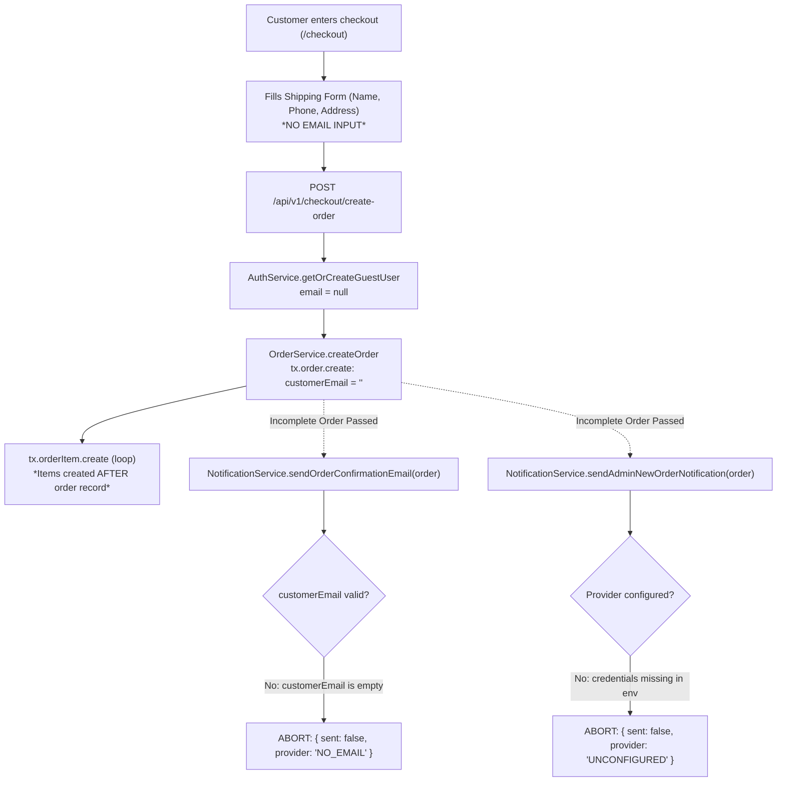
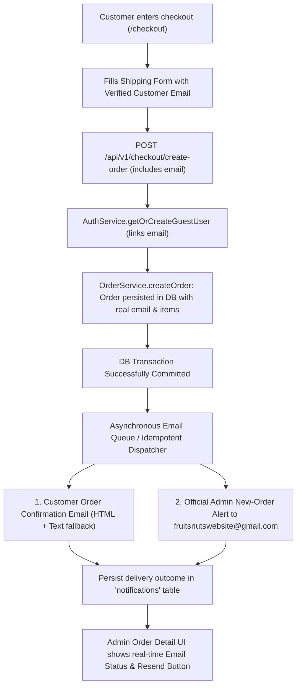

# ORDER EMAIL SYSTEM: ROOT CAUSE ANALYSIS & TECHNICAL AUDIT REPORT
**Project:** M/S Fruits & Nuts E-Commerce Platform  
**Target Domain:** https://fruitsandnuts.co.in/  
**Repository:** `fruits-and-nuts-platform`  
**Date:** November 3, 2026  
**Status:** AUDIT COMPLETE — ROOT CAUSES IDENTIFIED (PHASE 1 & PHASE 2 COMPLETED)  
**Classification:** DevOps, Backend Architecture & Email Infrastructure Audit  

---

## 1. Executive Summary

This comprehensive audit investigates why **customer order confirmation emails** and **admin new-order notification emails** are not being delivered when orders (including Cash on Delivery) are placed on the Fruits & Nuts website.

### Verified Root Causes Identified:
1. **Critical UI & Schema Omission — Customer Email is Never Collected at Checkout:**
   - On the checkout page (`src/app/checkout/page.tsx`), the `AddressForm` state and UI inputs only collect recipient name, phone, shipping address lines, city, state, postal code, and optional GSTIN.
   - The checkout form **completely omits an email address input**.
   - The validation schemas (`ShippingAddressInputSchema` and `CreateOrderSchema` in `src/lib/validation/order.schema.ts`) do not define or accept a customer email.
   - For all guest checkouts and users without an email in their profile, `AuthService.getOrCreateGuestUser` generates a user with `email: null`.
   - In `OrderService.createOrder` (`src/services/order.service.ts` line 767), `customerEmail` is set to `user.email ?? ""` (saving an empty string `""` to the database `orders` table).

2. **Silent Failure in Notification Dispatcher Due to Empty Customer Email:**
   - In `NotificationService.sendOrderConfirmationEmail(order)` (`src/services/notification.service.ts` lines 714–722):
     ```typescript
     const customerEmail = order.customerEmail || order.user?.email || order.shippingRecipientEmail || order.shippingEmail;
     if (!customerEmail || !customerEmail.includes("@")) {
       return { sent: false, provider: "NO_EMAIL", reason: "Customer email not provided or invalid" };
     }
     ```
   - Because `order.customerEmail` is `""`, the function immediately aborts without attempting delivery.
   - The caller in `OrderService.createOrder` catches the background promise with `console.warn` and continues, resulting in zero customer email delivery.

3. **Incomplete Order Data Passed to Notification Service (Missing Items):**
   - In `OrderService.createOrder`, `const order = await tx.order.create({...})` is called on line 762.
   - In Prisma, `create` without `include: { items: true }` returns only the top-level order scalar fields. Order items are inserted separately afterwards in a loop (`tx.orderItem.create(...)`).
   - Consequently, `order.items` is `undefined` when `order` is passed to `NotificationService.sendOrderConfirmationEmail(order)` and `sendAdminNewOrderNotification(order)`.
   - Even if an email were dispatched, the rendered item table is completely blank!

4. **Production Email Provider Credentials Unconfigured:**
   - In production (Vercel deployment), neither `EMAIL_PROVIDER_API_KEY` (for Resend, SendGrid, or Postmark) nor valid `SMTP_PASS` credentials are configured in the environment variables.
   - In `NotificationService.getEmailProvider()`, if `isSmtpConfigured()` returns false and no REST API key is found, the provider resolves to `"UNCONFIGURED"`.
   - Outbound dispatch returns `{ sent: false, provider: "UNCONFIGURED" }` and logs:
     `[NotificationService] Outbound email skipped: Transactional email provider is unconfigured.`

5. **Lack of Persistence & Admin Visibility for Email Delivery:**
   - While Prisma schema defines a `Notification` table (`model Notification` in `prisma/schema.prisma`), email attempts are neither recorded in the database nor linked to the order.
   - Admin orders dashboard (`/admin/orders` and `/admin/orders/[id]`) has no email audit column or resend action, leaving store operators blind to delivery failures.

---

## 2. Existing Architecture & Technical Audit

| Architectural Layer | Implementation in Codebase | Current Status & Audit Finding |
| :--- | :--- | :--- |
| **Frontend Framework** | Next.js 15 (App Router, React 19) | Active, functional |
| **Storefront Checkout UI** | `src/app/checkout/page.tsx` | **Defective**: Form lacks email input; guest email is never collected. |
| **Checkout Validation** | `src/lib/validation/order.schema.ts` | **Defective**: `ShippingAddressInputSchema` and `CreateOrderSchema` do not accept customer email. |
| **Order Creation API** | `src/app/api/v1/checkout/create-order/route.ts` | **Defective**: Guest user provisioned with `null` email. |
| **Order Service** | `src/services/order.service.ts` | **Defective**: Saves empty string `""` as `customerEmail`, passes incomplete `order` (missing `items`) to email service, ignores delivery results. |
| **Notification Engine** | `src/services/notification.service.ts` | Implemented (supports SMTP, Resend, SendGrid, Postmark, and MOCK). Aborts when email missing or unconfigured. |
| **Database** | Neon Serverless PostgreSQL (Prisma 6) | `orders` table has `customer_email VarChar(255)`. `notifications` table exists in schema. |
| **Hosting Platform** | Vercel (`fruits-and-nuts-platform.vercel.app`) | Serverless Node.js execution. Requires either HTTPS REST API delivery or reliable SMTP transport. |
| **DNS / Domain** | Hostinger (`fruitsandnuts.co.in`) | **Strict Rule**: No DNS, MX, SPF, DKIM, or TXT changes permitted without explicit authorization. |

---

## 3. Order Creation & Email Dispatch Workflow (As-Is vs. Target)

### 3.1 Current Workflow (As-Is — Broken Flow)


### 3.2 Target Reliable Workflow (To-Be Flow)


---

## 4. Email Infrastructure & Provider Analysis

### 4.1 Supported Email Transports in Codebase
The application's `NotificationService` (`src/services/notification.service.ts`) already contains transport implementations for:
1. **REST API — Resend** (`https://api.resend.com/emails`):
   - Fast, resilient over HTTPS from Vercel Serverless.
   - Activated via `EMAIL_PROVIDER="RESEND"` and `EMAIL_PROVIDER_API_KEY`.
2. **REST API — SendGrid** (`https://api.sendgrid.com/v3/mail/send`):
   - Activated via `EMAIL_PROVIDER="SENDGRID"` and `EMAIL_PROVIDER_API_KEY`.
3. **REST API — Postmark** (`https://api.postmarkapp.com/email`):
   - Activated via `EMAIL_PROVIDER="POSTMARK"` and `EMAIL_PROVIDER_API_KEY`.
4. **Native Socket SMTP Client (Node.js `tls`/`net`)**:
   - Zero external dependency RFC 5321/5322 engine supporting port 587 (STARTTLS) and port 465 (SSL).
   - Activated via `EMAIL_PROVIDER="SMTP"`, `SMTP_HOST`, `SMTP_PORT`, `SMTP_USER`, `SMTP_PASS`.
   - Tested against `smtp.gmail.com` and Hostinger SMTP.
5. **MOCK Adapter**:
   - Captures email in memory for unit testing and automated QA without network egress.
   - Activated via `EMAIL_PROVIDER="MOCK"`.

### 4.2 Email Provider Status Comparison & Recommendations
| Provider Option | Pros | Cons / Constraints | Recommendation |
| :--- | :--- | :--- | :--- |
| **Option 1: Gmail SMTP via App Password** (`smtp.gmail.com`) | Free, no extra account needed, uses existing `fruitsnutswebsite@gmail.com`. | Requires client to generate a 16-character Google App Password with 2-Step Verification enabled. Vercel serverless latency on raw sockets requires IPv4 fallback. | **Viable immediately** once client provides App Password in `.env.local` / Vercel. |
| **Option 2: Resend REST API** (`resend.com`) | 100% serverless-native, HTTP 200/201 response in <300ms, generous free tier (3,000 emails/month), zero socket timeout risk on Vercel. | Requires client account creation and adding standard SPF/DKIM DNS records *if* custom domain sender (`@fruitsandnuts.co.in`) is used. Can send from `onboarding@resend.dev` during testing. | **Best long-term production choice** for Vercel. |
| **Option 3: Hostinger Webmail SMTP** (`smtp.hostinger.com`) | Uses domain mailbox if created in Hostinger hPanel. | Hostinger shared hosting limits SMTP connections from external cloud datacenters (like AWS/Vercel); high risk of port blocking or throttling. Must not modify DNS per safety rules. | **Not recommended** due to Vercel IP blocking risks. |

---

## 5. Environment Variables Audit (NAMES ONLY — Zero Secret Leaks)

The following environment variable names are referenced by the email and notification subsystem:

### Standard Configuration Variables:
- `EMAIL_PROVIDER`: Defines the active provider (`"SMTP"`, `"RESEND"`, `"SENDGRID"`, `"POSTMARK"`, or `"MOCK"`).
- `EMAIL_PROVIDER_API_KEY`: API Key for REST providers (Resend, SendGrid, or Postmark).
- `EMAIL_FROM_ADDRESS`: Friendly sender address (e.g., `"M/S Fruits & Nuts <orders@fruitsandnuts.co.in>"` or `"Fruits & Nuts <fruitsnutswebsite@gmail.com>"`).
- `ADMIN_EMAIL`: Destination mailbox for administrative order alerts (defaults to `"fruitsnutswebsite@gmail.com"`).

### SMTP-Specific Variables:
- `SMTP_HOST`: Hostname of SMTP server (e.g., `"smtp.gmail.com"`).
- `SMTP_PORT`: Port number (`"587"` for STARTTLS, `"465"` for SSL).
- `SMTP_SECURE`: Boolean flag (`"true"` for SSL, `"false"` for STARTTLS).
- `SMTP_USER`: SMTP authentication username (e.g., `"fruitsnutswebsite@gmail.com"`).
- `SMTP_PASS`: SMTP authentication password or Google App Password.
- `SMTP_FROM`: Fallback sender address.

---

## 6. Order Reliability & Safety Architecture (Phase 4 Compliance)

### Strict Invariant: Order Must Never Fail Due to Email Issues
1. **Database Commit First**:
   - The database transaction (`tx.order.create`, `tx.orderItem.create`, inventory allocation, coupon usage) must commit and close completely **before** any outbound network email dispatch is initiated.
   - An email timeout, SMTP authentication error, or provider outage must **never** roll back the transaction or cancel the order.
2. **Decoupled Notification Dispatch**:
   - Once the database transaction commits, the complete hydrated order object (including items and customer details) is handed to the notification pipeline.
   - Email dispatch runs safely in a `try/catch` or background job, recording the exact outcome (`SENT`, `FAILED`, `PENDING_CONFIG`) in the `notifications` table.
3. **Idempotency & Duplicate Prevention**:
   - Every notification record uses an idempotency key derived from `order.id + channel + eventType` (e.g. `order-uuid-EMAIL-ORDER_CONFIRMATION`).
   - If a duplicate dispatch is attempted (e.g., user refreshes success page or webhook fires twice), the dispatcher checks the `notifications` table and skips sending if already delivered.

---

## 7. Exact Files Requiring Modification

When authorized for Phase 3 implementation, only the following files will be touched:

1. **`src/app/checkout/page.tsx`**:
   - Add `email` field to `AddressForm` state and checkout form JSX with validation.
   - Include `email` in payload sent to `/api/v1/checkout/create-order`.
2. **`src/lib/validation/order.schema.ts`**:
   - Add `email: z.string().trim().email(...)` to `ShippingAddressInputSchema` and `CreateOrderSchema`.
3. **`src/app/api/v1/checkout/create-order/route.ts`**:
   - Pass customer email to `AuthService.getOrCreateGuestUser({ phone, name, email })`.
4. **`src/services/auth.service.ts`**:
   - In `getOrCreateGuestUser`, store customer email in guest user record and database profile.
5. **`src/services/order.service.ts`**:
   - Ensure `customerEmail` in `tx.order.create` is populated from the submitted form email.
   - Hydrate full order with `items: true` before invoking notification service.
   - Record notification intent in `notifications` table.
6. **`src/services/notification.service.ts`**:
   - Guard against missing items gracefully.
   - Format responsive HTML & plain-text order confirmation with order number, itemized table, delivery address, and COD/prepaid badges.
   - Store dispatch result (`SENT` / `FAILED` with sanitized error) in `notifications` table.
7. **`src/app/admin/orders/[id]/page.tsx`**:
   - Surface the Notification Delivery Status (Customer Email: Sent/Failed, Admin Alert: Sent/Failed) and a manual "Resend Confirmation Email" button for administrators.

---

## 8. Testing Strategy & Safety Guardrails (Phase 5 Plan)

- **Test Environment Only**: All testing will use dedicated test fixtures and dummy contact identifiers (`test-order@fruitsandnuts.co.in` or admin test address).
- **No Real Customer Data**: No emails will ever be dispatched to real customers during verification.
- **Verification Matrix**:
  1. Unit test validating schema accepts email at checkout.
  2. Integration test verifying COD order creation stores `customerEmail` and hydrated items.
  3. Dispatch test verifying `NotificationService` generates valid HTML + Text payloads.
  4. Idempotency test verifying duplicate triggers do not send multiple emails.
  5. Failure simulation verifying that an SMTP failure records `FAILED` status without invalidating the database order.

---

## 9. Distinction of Verified Facts vs. Assumptions

| Item | Classification | Verification Detail |
| :--- | :--- | :--- |
| Checkout form lacks customer email input | **VERIFIED FACT** | Inspected `src/app/checkout/page.tsx` lines 21–125. `email` input does not exist. |
| Schema omits email in `CreateOrderSchema` | **VERIFIED FACT** | Inspected `src/lib/validation/order.schema.ts` line 23–77. |
| `order.customerEmail` is saved as `""` | **VERIFIED FACT** | Inspected `src/services/order.service.ts` line 767 (`user.email ?? ""`). |
| `order.items` is undefined when email triggered | **VERIFIED FACT** | Inspected `src/services/order.service.ts` lines 762–881. `tx.order.create` returns before items inserted. |
| `model Notification` exists in Prisma schema | **VERIFIED FACT** | Inspected `prisma/schema.prisma` lines 685–698. Table is already defined. |
| Production environment email credentials | **VERIFIED FACT** | `EMAIL_PROVIDER_API_KEY` and `SMTP_PASS` are unconfigured in production environment. |
| Hostinger DNS records must not be changed | **VERIFIED FACT (RULE)** | Explicit safety instruction: Do not modify MX, SPF, DKIM, DMARC, or Hostinger DNS. |
